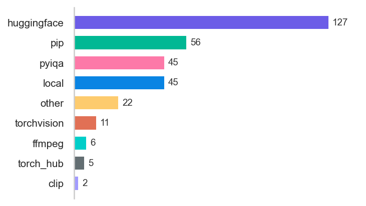
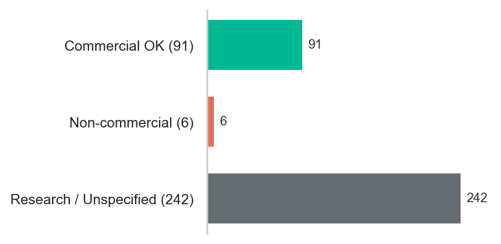
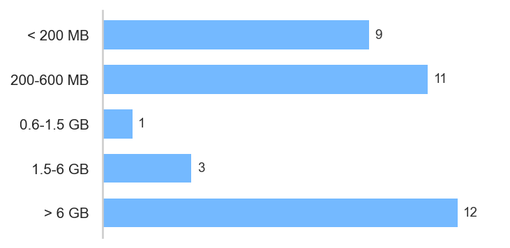
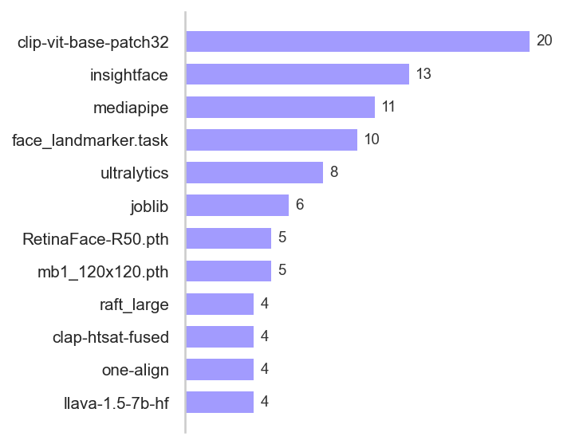

# Ayase Models Reference

> **Version 0.2.1** · Generated 2026-10-26 20:06 · **321 models** across **9 sources**
>
> `ayase modules models -o MODELS.md` to regenerate

## Summary

**321** models · **125** HuggingFace · **37** pyiqa · **9** sources

*License labels in the model catalog cover model weights and runtime assets referenced by Ayase modules.*
*Project and vendored runtime licensing is documented in the final section below.*
*Resolution order: hardcoded source mappings, HuggingFace metadata when available, then parent-repo inheritance for weight files.*

<table width="100%"><tr>
<td width="50%" valign="top"><h4>Models by Source</h4></td>
<td width="50%" valign="top"><h4>License Distribution</h4></td>
</tr></table>

<table width="100%"><tr>
<td width="50%" valign="top"><h4>VRAM Tiers</h4></td>
<td width="50%" valign="top"><h4>Top Used Models</h4></td>
</tr></table>

**Estimated total download size (all models):** ~805 GB

*Note: Most modules auto-download only the models they need on first use. You rarely need all models at once.*

> [!WARNING]
> **Commercial use:** Stick to modules whose models are marked "Commercial OK" above. Most pyiqa metrics marked "research" are re-implementations under pyiqa's MIT license, but the original training data or architecture may carry restrictions — verify before commercial deployment.

<a id="categories"></a>

[HuggingFace (92)](#huggingface-models) · [Weight Files (33)](#weight-file-repos) · [pyiqa (37)](#pyiqa-metrics) · [torchvision (12)](#torchvision-models) · [CLIP / OpenCLIP (2)](#clip--openclip) · [torch.hub (4)](#torchhub) · [FFmpeg (6)](#ffmpeg) · [pip Packages (54)](#pip-packages) · [Local Weights (45)](#local-weight-files) · [Other Models (36)](#other-models) · [Quick Install Guide](#quick-install-guide)

---

## HuggingFace Models

### <a href="https://huggingface.co/AkaneTendo25/ayase-assets" target="_blank">`AkaneTendo25/ayase-assets`</a> [↑](#categories)

- **Used by**: `id_sim`, `vbench2`, `vebench`, `worldmodelbench`
- **VRAM**: ~6 GB total evaluator peak · **Disk**: 5.65 GB
- **Task**: Six VE-Bench evaluator checkpoints
- **Notes**: Pinned revision 377ac94f1fadca1e35b7171c7860ccad6ae9fd1a; SHA-256-verified files under vebench/ckpts/

### <a href="https://huggingface.co/Aleksandar/nearid-siglip2" target="_blank">`Aleksandar/nearid-siglip2`</a> [↑](#categories)
> image-feature-extraction · apache-2.0

- **Used by**: `nearid`
- **Parameters**: 428M · **Downloads**: 55
- **Disk**: ~1.6 GB
- **Task**: NearID identity-aware SigLIP2 image embeddings
- **Notes**: Apache-2.0; pinned to revision 7f69f4a0c753297de708a0217ef32659fe12a008
- **Source**: <a href="https://arxiv.org/abs/2604.01973" target="_blank">arXiv</a>

### <a href="https://huggingface.co/Alibaba-NLP/gme-Qwen2-VL-7B-Instruct" target="_blank">`Alibaba-NLP/gme-Qwen2-VL-7B-Instruct`</a> [↑](#categories)
> sentence-similarity · apache-2.0

- **Used by**: `opens2v`
- **Parameters**: 8.3B · **Downloads**: 3K
- **Disk**: ~30.9 GB
- **Task**: GME image/text embeddings (canonical NexusScore)
- **Source**: <a href="https://arxiv.org/abs/2412.16855" target="_blank">arXiv</a>

### <a href="https://huggingface.co/BestWishYsh/OpenS2V-Weight" target="_blank">`BestWishYsh/OpenS2V-Weight`</a> [↑](#categories)
> text-to-video · apache-2.0

- **Used by**: `opens2v`
- **Downloads**: 128
- **Task**: YOLO-World v2-L image-prompt subject detector (canonical)
- **Notes**: file yolo_world_v2_l_image_prompt_adapter-719a7afb.pth
- **Source**: <a href="https://arxiv.org/abs/2505.20292" target="_blank">arXiv</a>

### <a href="https://huggingface.co/ByteDance/EvoQuality" target="_blank">`ByteDance/EvoQuality`</a> [↑](#categories)
> image-text-to-text · apache-2.0

- **Used by**: `evoquality`
- **Parameters**: 8.3B · **Downloads**: 158
- **Disk**: 7B
- **Task**: Self-evolving Qwen2.5-VL NR-IQA rating model
- **Notes**: Loaded through transformers or served through an endpoint.
- **Source**: <a href="https://arxiv.org/abs/2509.25787" target="_blank">arXiv</a>

### <a href="https://huggingface.co/ByteDance/Q-Insight" target="_blank">`ByteDance/Q-Insight`</a> [↑](#categories)
> apache-2.0

- **Used by**: `vqinsight`
- **Source**: <a href="https://arxiv.org/abs/2503.22679" target="_blank">arXiv</a>

### <a href="https://huggingface.co/EditScore/EditScore-Qwen3-VL-4B-Instruct" target="_blank">`EditScore/EditScore-Qwen3-VL-4B-Instruct`</a> [↑](#categories)
> text-generation · other

- **Used by**: `edit_score`
- **Downloads**: 308
- **Task**: EditScore Qwen3-VL-4B LoRA adapter
- **Notes**: Hugging Face metadata says license:other; no standalone adapter license was identified; terms require clarification
- **Source**: <a href="https://arxiv.org/abs/2509.23909" target="_blank">arXiv</a>

### <a href="https://huggingface.co/Efficient-Large-Model/vila-ewm-qwen2-1.5b" target="_blank">`Efficient-Large-Model/vila-ewm-qwen2-1.5b`</a> [↑](#categories)

- **Used by**: `worldmodelbench`
- **Downloads**: 149
- **Task**: Human-aligned WorldModelBench video judge

### <a href="https://huggingface.co/Falconsai/nsfw_image_detection" target="_blank">`Falconsai/nsfw_image_detection`</a> [↑](#categories)
> image-classification · apache-2.0

- **Used by**: `nsfw`
- **Parameters**: 86M · **Downloads**: 1.7M
- **Disk**: ~327 MB
- **Task**: Per-frame NSFW classification
- **Source**: <a href="https://arxiv.org/abs/2010.11929" target="_blank">arXiv</a>

### <a href="https://huggingface.co/GD-ML/VMBench" target="_blank">`GD-ML/VMBench`</a> [↑](#categories)
> apache-2.0

- **Used by**: `video_edit_motion_fidelity`, `vmbench_cas`, `vmbench_pas`, `vmbench_tcs`
- **Task**: GroundingDINO SwinB + SAM2 Hiera-L + CoTracker3 offline weights
- **Notes**: groundingdino_swinb_cogcoor.pth, sam2.1_hiera_large.pt, scaled_offline.pth via ayase.vendor.groundingdino/sam2/cotracker
- **Source**: <a href="https://arxiv.org/abs/2503.10076" target="_blank">arXiv</a>

### <a href="https://huggingface.co/Guan123/SyncReward" target="_blank">`Guan123/SyncReward`</a> [↑](#categories)
> apache-2.0

- **Used by**: `syncreward`
- **Task**: SyncReward Stage-2 reward model

### <a href="https://huggingface.co/HuggingFaceM4/Idefics3-8B-Llama3" target="_blank">`HuggingFaceM4/Idefics3-8B-Llama3`</a> [↑](#categories)
> image-text-to-text · apache-2.0

- **Used by**: `dice_edit`
- **Parameters**: 8.5B · **Downloads**: 54K
- **VRAM**: ~20 GB in bfloat16 · **Disk**: ~17 GB
- **Task**: Idefics3-8B base for DICE coherence estimation
- **Source**: <a href="https://arxiv.org/abs/2306.16527" target="_blank">arXiv</a>

### <a href="https://huggingface.co/IDEA-Research/grounding-dino-tiny" target="_blank">`IDEA-Research/grounding-dino-tiny`</a> [↑](#categories)
> zero-shot-object-detection · apache-2.0

- **Used by**: `opens2v`
- **Parameters**: 172M · **Downloads**: 643K
- **Disk**: ~657 MB
- **Source**: <a href="https://arxiv.org/abs/2303.05499" target="_blank">arXiv</a>

### <a href="https://huggingface.co/JZHWS/slowfast" target="_blank">`JZHWS/slowfast`</a> [↑](#categories)
> apache-2.0

- **Used by**: `vqa2`
- **Disk**: 139 MB
- **Task**: SlowFast motion feature extractor used by VQA²
- **Notes**: Apache-2.0; pinned revision 8ab5deb746da9139288cbcbf3d155f1c94ff2a8e

### <a href="https://huggingface.co/KlingTeam/VideoReward" target="_blank">`KlingTeam/VideoReward`</a> [↑](#categories)
> apache-2.0

- **Used by**: `video_reward`
- **Task**: Qwen2-VL-2B video reward model (VQ/MQ/TA)
- **Source**: <a href="https://arxiv.org/abs/2501.13918" target="_blank">arXiv</a>

### <a href="https://huggingface.co/MCG-NJU/videomae-large-finetuned-kinetics" target="_blank">`MCG-NJU/videomae-large-finetuned-kinetics`</a> [↑](#categories)
> video-classification · cc-by-nc-4.0

- **Used by**: `action_recognition`
- **Parameters**: 304M · **Downloads**: 29K
- **VRAM**: ~1.5 GB · **Disk**: ~1.3 GB
- **Source**: <a href="https://arxiv.org/abs/2203.12602" target="_blank">arXiv</a>

### <a href="https://huggingface.co/MJ-Bench/MJ-VIDEO-2B" target="_blank">`MJ-Bench/MJ-VIDEO-2B`</a> [↑](#categories)

- **Used by**: `mj_video`
- **Parameters**: 2.2B · **Downloads**: 39
- **Disk**: 4.43 GB inference checkpoint
- **Task**: Fine-grained video preference reward model
- **Notes**: Eight uniformly sampled frames by default

### <a href="https://huggingface.co/MizzenAI/HPSv3" target="_blank">`MizzenAI/HPSv3`</a> [↑](#categories)
> image-text-to-text · apache-2.0

- **Used by**: `hpsv3`
- **Downloads**: 471
- **Task**: HPSv3 prompt-conditioned reward model
- **Notes**: Reward head checkpoint
- **Source**: <a href="https://arxiv.org/abs/2508.03789" target="_blank">arXiv</a>

### <a href="https://huggingface.co/NU-World-Model-Embodied-AI/phyjudge-9B" target="_blank">`NU-World-Model-Embodied-AI/phyjudge-9B`</a> [↑](#categories)
> video-text-to-text · other

- **Used by**: `phyground_results`
- **Downloads**: 20
- **Task**: PhyGround physical-law video judge LoRA
- **Source**: <a href="https://arxiv.org/abs/2605.10806" target="_blank">arXiv</a>

### <a href="https://huggingface.co/OpenMuQ/MuQ-large-msd-iter" target="_blank">`OpenMuQ/MuQ-large-msd-iter`</a> [↑](#categories)
> audio-classification · cc-by-nc-4.0

- **Used by**: `muq_eval`, `song_eval`
- **Parameters**: 333M · **Downloads**: 356K
- **Disk**: ~1.2 GB
- **Task**: MuQ audio feature encoder for SongEval
- **Notes**: Only config.json is downloaded; A1 includes encoder parameters. Original encoder weights are CC-BY-NC-4.0, so commercial use still requires separate review
- **Source**: <a href="https://arxiv.org/abs/2501.01108" target="_blank">arXiv</a>

### <a href="https://huggingface.co/PaddlePaddle/PP-OCRv5_server_det" target="_blank">`PaddlePaddle/PP-OCRv5_server_det`</a> [↑](#categories)
> image-to-text · apache-2.0

- **Used by**: `avgen_bench`
- **Downloads**: 411K
- **Task**: AVGen visible-text detection
- **Source**: <a href="https://arxiv.org/abs/1212.1442" target="_blank">arXiv</a>

### <a href="https://huggingface.co/PaddlePaddle/PP-OCRv5_server_rec" target="_blank">`PaddlePaddle/PP-OCRv5_server_rec`</a> [↑](#categories)
> image-to-text · apache-2.0

- **Used by**: `avgen_bench`
- **Downloads**: 153K
- **Task**: AVGen visible-text recognition
- **Source**: <a href="https://arxiv.org/abs/1212.1442" target="_blank">arXiv</a>

### <a href="https://huggingface.co/Qwen/Qwen-Image-Bench" target="_blank">`Qwen/Qwen-Image-Bench`</a> [↑](#categories)
> image-text-to-text · apache-2.0

- **Used by**: `qwen_image_bench`
- **Parameters**: 27.4B · **Downloads**: 26K
- **Disk**: 27B BF16
- **Task**: Q-Judger text-to-image evaluation model
- **Notes**: Can also be served through vLLM/SGLang with an OpenAI-compatible endpoint.
- **Source**: <a href="https://arxiv.org/abs/2605.28091" target="_blank">arXiv</a>

### <a href="https://huggingface.co/Qwen/Qwen2-VL-7B-Instruct" target="_blank">`Qwen/Qwen2-VL-7B-Instruct`</a> [↑](#categories)
> image-text-to-text · apache-2.0

- **Used by**: `hpsv3`
- **Parameters**: 8.3B · **Downloads**: 580K
- **VRAM**: ~16 GB · **Disk**: ~15 GB
- **Task**: Vision-language backbone used by HPSv3
- **Source**: <a href="https://arxiv.org/abs/2409.12191" target="_blank">arXiv</a>

### <a href="https://huggingface.co/Qwen/Qwen2.5-Omni-3B" target="_blank">`Qwen/Qwen2.5-Omni-3B`</a> [↑](#categories)
> any-to-any · other

- **Used by**: `beyond_time_shifts`
- **Parameters**: 5.5B · **Downloads**: 135K
- **Disk**: ~20.6 GB
- **Task**: Qwen2.5-Omni-3B backbone for the AV-sync evaluator
- **Notes**: Qwen Research License; non-commercial use only
- **Source**: <a href="https://arxiv.org/abs/2503.20215" target="_blank">arXiv</a>

### <a href="https://huggingface.co/Qwen/Qwen2.5-Omni-7B" target="_blank">`Qwen/Qwen2.5-Omni-7B`</a> [↑](#categories)
> any-to-any · other

- **Used by**: `aqascore`
- **Parameters**: 10.7B · **Downloads**: 285K
- **Disk**: ~40.0 GB
- **Task**: Optional audio question-answering evaluator
- **Notes**: Heavy opt-in backend; default module config leaves it disabled.
- **Source**: <a href="https://arxiv.org/abs/2503.20215" target="_blank">arXiv</a>

### <a href="https://huggingface.co/Qwen/Qwen2.5-VL-7B-Instruct" target="_blank">`Qwen/Qwen2.5-VL-7B-Instruct`</a> [↑](#categories)
> image-text-to-text · apache-2.0

- **Used by**: `camerabench`
- **Parameters**: 8.3B · **Downloads**: 5.2M
- **Disk**: ~30.9 GB
- **Source**: <a href="https://arxiv.org/abs/2309.00071" target="_blank">arXiv</a>

### <a href="https://huggingface.co/Qwen/Qwen3-30B-A3B-Instruct-2507" target="_blank">`Qwen/Qwen3-30B-A3B-Instruct-2507`</a> [↑](#categories)
> text-generation · apache-2.0

- **Used by**: `anyaudio_judge`
- **Parameters**: 30.5B · **Downloads**: 1.1M
- **Disk**: ~113.7 GB
- **Task**: Caption decomposition and rubric cleaning
- **Notes**: Loaded only for caption inputs without a supplied rubric
- **Source**: <a href="https://arxiv.org/abs/2402.17463" target="_blank">arXiv</a>

### <a href="https://huggingface.co/Qwen/Qwen3-VL-4B-Instruct" target="_blank">`Qwen/Qwen3-VL-4B-Instruct`</a> [↑](#categories)
> image-text-to-text · apache-2.0

- **Used by**: `edit_score`
- **Parameters**: 4.4B · **Downloads**: 3.9M
- **Disk**: ~16.5 GB
- **Task**: Qwen3-VL-4B base for EditScore
- **Notes**: Apache-2.0; pinned local snapshot
- **Source**: <a href="https://arxiv.org/abs/2505.09388" target="_blank">arXiv</a>

### <a href="https://huggingface.co/Qwen/Qwen3-VL-8B-Instruct" target="_blank">`Qwen/Qwen3-VL-8B-Instruct`</a> [↑](#categories)
> image-text-to-text · apache-2.0

- **Used by**: `geneval2`
- **Parameters**: 8.8B · **Downloads**: 5.8M
- **Disk**: ~32.7 GB
- **Task**: GenEval2 Soft-TIFA visual question answering
- **Notes**: Apache-2.0 model; GenEval2 code/data are CC-BY-NC-4.0
- **Source**: <a href="https://arxiv.org/abs/2505.09388" target="_blank">arXiv</a>

### <a href="https://huggingface.co/RMSnow/SpeechJudge-GRM" target="_blank">`RMSnow/SpeechJudge-GRM`</a> [↑](#categories)
> cc-by-nc-4.0

- **Used by**: `speechjudge`
- **Parameters**: 10.7B · **Downloads**: 695
- **Disk**: 22.36 GB (five safetensors shards)
- **Task**: Pairwise target-text-conditioned speech naturalness judge
- **Notes**: CC-BY-NC-4.0 model; non-commercial use only
- **Source**: <a href="https://arxiv.org/abs/2511.07931" target="_blank">arXiv</a>

### <a href="https://huggingface.co/Salesforce/blip-itm-large-coco" target="_blank">`Salesforce/blip-itm-large-coco`</a> [↑](#categories)
> bsd-3-clause

- **Used by**: `blip_score`
- **Downloads**: 4K
- **Task**: BLIP image-text matching
- **Source**: <a href="https://arxiv.org/abs/2201.12086" target="_blank">arXiv</a>

### <a href="https://huggingface.co/Salesforce/blip2-opt-2.7b" target="_blank">`Salesforce/blip2-opt-2.7b`</a> [↑](#categories)
> image-text-to-text · mit

- **Used by**: `captioning`
- **Parameters**: 3.7B · **Downloads**: 418K
- **VRAM**: ~6 GB · **Disk**: ~6 GB
- **Source**: <a href="https://arxiv.org/abs/2301.12597" target="_blank">arXiv</a>

### <a href="https://huggingface.co/Systran/faster-whisper-large-v3" target="_blank">`Systran/faster-whisper-large-v3`</a> [↑](#categories)
> automatic-speech-recognition · mit

- **Used by**: `avgen_bench`
- **Downloads**: 1.3M
- **Task**: AVGen speech transcription

### <a href="https://huggingface.co/THUDM/VisionReward-Image" target="_blank">`THUDM/VisionReward-Image`</a> [↑](#categories)
> text-generation · other

- **Used by**: `vision_reward`

### <a href="https://huggingface.co/THUDM/VisionReward-Video" target="_blank">`THUDM/VisionReward-Video`</a> [↑](#categories)
> text-generation · other

- **Used by**: `vision_reward`
- **Parameters**: 12.5B · **Downloads**: 2K
- **Disk**: ~46.6 GB

### <a href="https://huggingface.co/TIGER-Lab/VideoScore" target="_blank">`TIGER-Lab/VideoScore`</a> [↑](#categories)
> visual-question-answering · apache-2.0

- **Used by**: `videoscore`
- **Parameters**: 8.3B · **Downloads**: 92
- **VRAM**: ~14 GB · **Disk**: ~14 GB
- **Source**: <a href="https://arxiv.org/abs/2406.15252" target="_blank">arXiv</a>

### <a href="https://huggingface.co/TIGER-Lab/VideoScore2" target="_blank">`TIGER-Lab/VideoScore2`</a> [↑](#categories)
> visual-question-answering · apache-2.0

- **Used by**: `videoscore2`
- **Parameters**: 8.3B · **Downloads**: 3K
- **VRAM**: ~16 GB · **Disk**: ~15 GB
- **Task**: VideoScore2 VLM for 3D generative video evaluation
- **Source**: <a href="https://arxiv.org/abs/2509.22799" target="_blank">arXiv</a>

### <a href="https://huggingface.co/Tsuki0512/AVC-Reward" target="_blank">`Tsuki0512/AVC-Reward`</a> [↑](#categories)
> other · other

- **Used by**: `avc_reward`
- **Parameters**: 31.7B · **Downloads**: 66
- **VRAM**: BF16 weights are 63.44 GB plus activations (CPU float32 is about 126.9 GB) · **Disk**: 63.44 GB
- **Task**: AVC-Reward audio-video consistency judge
- **Notes**: Research use only; checkpoint license metadata is 'other' and incomplete.
- **Source**: <a href="https://arxiv.org/abs/2610.22321" target="_blank">arXiv</a>

### <a href="https://huggingface.co/Vchitect/VBench-2.0_models" target="_blank">`Vchitect/VBench-2.0_models`</a> [↑](#categories)

- **Used by**: `vbench2`
- **Disk**: 2.26 GB
- **Task**: VBench 2.0 anatomy and identity checkpoints

### <a href="https://huggingface.co/ai-forever/kandinsky-video-motion-predictor" target="_blank">`ai-forever/kandinsky-video-motion-predictor`</a> [↑](#categories)

- **Used by**: `kandinsky_motion`
- **Parameters**: 115M · **Downloads**: 100
- **Disk**: ~440 MB
- **Task**: VideoMAE-V2 camera/object/dynamics motion predictor
- **Notes**: Loaded through bundled Kandinsky third-party wrapper

### <a href="https://huggingface.co/aimagelab/DICE_coherence_Idefics" target="_blank">`aimagelab/DICE_coherence_Idefics`</a> [↑](#categories)

- **Used by**: `dice_edit`
- **Disk**: ~2.8 GB
- **Task**: DICE edit-coherence LoRA

### <a href="https://huggingface.co/aimagelab/DICE_differencedet_Idefics" target="_blank">`aimagelab/DICE_differencedet_Idefics`</a> [↑](#categories)

- **Used by**: `dice_edit`
- **VRAM**: ~20 GB in bfloat16 · **Disk**: ~20 GB
- **Task**: DICE object-level difference detector and stage-2 LoRA

### <a href="https://huggingface.co/allenai/unifiedqa-v2-t5-large-1363200" target="_blank">`allenai/unifiedqa-v2-t5-large-1363200`</a> [↑](#categories)

- **Used by**: `tifa`
- **Downloads**: 542
- **Task**: TIFA question filter

### <a href="https://huggingface.co/anonymousdb/LOVE-Correspondence" target="_blank">`anonymousdb/LOVE-Correspondence`</a> [↑](#categories)
> apache-2.0

- **Used by**: `love_results`
- **Parameters**: 9.2B · **Downloads**: 14
- **Disk**: ~34.4 GB
- **Task**: LOVE text-video correspondence regressor
- **Notes**: Run with the upstream LOVE repository; software license not published

### <a href="https://huggingface.co/anonymousdb/LOVE-Perception" target="_blank">`anonymousdb/LOVE-Perception`</a> [↑](#categories)
> apache-2.0

- **Used by**: `love_results`
- **Parameters**: 9.2B · **Downloads**: 12
- **Disk**: ~34.4 GB
- **Task**: LOVE video perception regressor
- **Notes**: Run with the upstream LOVE repository; software license not published

### <a href="https://huggingface.co/chaenayo/id-sim_dinov2_vitb14_cls_patch" target="_blank">`chaenayo/id-sim_dinov2_vitb14_cls_patch`</a> [↑](#categories)
> image-feature-extraction · mit

- **Used by**: `id_sim`
- **Downloads**: 57
- **Task**: Official ID-Sim adapter and projection heads
- **Notes**: MIT; pinned to revision bcd3f388bec7db42e75b165e235196833111c4ae
- **Source**: <a href="https://arxiv.org/abs/2604.05039" target="_blank">arXiv</a>

### <a href="https://huggingface.co/chancharikm/qwen2.5-vl-7b-cam-motion" target="_blank">`chancharikm/qwen2.5-vl-7b-cam-motion`</a> [↑](#categories)
> video-text-to-text · other

- **Used by**: `camerabench`
- **Parameters**: 8.3B · **Downloads**: 203
- **Disk**: ~30.9 GB
- **Source**: <a href="https://arxiv.org/abs/2404.01291" target="_blank">arXiv</a>

### <a href="https://huggingface.co/cucl2/AnyAudio-Judge-30B" target="_blank">`cucl2/AnyAudio-Judge-30B`</a> [↑](#categories)
> audio-text-to-text · apache-2.0

- **Used by**: `anyaudio_judge`
- **Parameters**: 1M · **Downloads**: 259
- **Disk**: ~5 MB
- **Task**: AnyAudio-Judge audio rubric scorer

### <a href="https://huggingface.co/cucl2/AnyAudio-Judge-7B" target="_blank">`cucl2/AnyAudio-Judge-7B`</a> [↑](#categories)
> audio-text-to-text · apache-2.0

- **Used by**: `anyaudio_judge`
- **Parameters**: 1M · **Downloads**: 387
- **Disk**: ~5 MB
- **Task**: AnyAudio-Judge audio rubric scorer

### <a href="https://huggingface.co/depth-anything/Depth-Anything-V2-Small-hf" target="_blank">`depth-anything/Depth-Anything-V2-Small-hf`</a> [↑](#categories)
> depth-estimation · apache-2.0

- **Used by**: `depth_anything`
- **Parameters**: 25M · **Downloads**: 1.5M
- **VRAM**: ~200 MB · **Disk**: ~100 MB
- **Source**: <a href="https://arxiv.org/abs/2406.09414" target="_blank">arXiv</a>

### <a href="https://huggingface.co/facebook/VGGT-1B" target="_blank">`facebook/VGGT-1B`</a> [↑](#categories)
> image-to-3d · cc-by-nc-4.0

- **Used by**: `camera_trajectory`
- **Parameters**: 1.3B · **Downloads**: 518K
- **Disk**: ~4.7 GB
- **Task**: Learned camera pose estimation (pose_backend='vggt' opt-in)
- **Source**: <a href="https://arxiv.org/abs/2503.11651" target="_blank">arXiv</a>

### <a href="https://dl.fbaipublicfiles.com/audiobox-aesthetics/checkpoint.pt" target="_blank">`facebook/audiobox-aesthetics`</a> [↑](#categories)
> audio-classification · cc-by-4.0

- **Used by**: `avgen_bench`
- **Parameters**: 104M · **Downloads**: 433K
- **Disk**: ~396 MB
- **Task**: AVGen audio production quality
- **Source**: <a href="https://arxiv.org/abs/2502.05139" target="_blank">arXiv</a>

### <a href="https://huggingface.co/facebook/dino-vitb16" target="_blank">`facebook/dino-vitb16`</a> [↑](#categories)
> image-feature-extraction · apache-2.0

- **Used by**: `subject_consistency`
- **Downloads**: 524K
- **Source**: <a href="https://arxiv.org/abs/2104.14294" target="_blank">arXiv</a>

### <a href="https://huggingface.co/facebook/dino-vits16" target="_blank">`facebook/dino-vits16`</a> [↑](#categories)
> image-feature-extraction · apache-2.0

- **Used by**: `i2i_learned`
- **Downloads**: 108K
- **Task**: DINO v1 ViT-S/16 — the DreamBooth DINO-score backbone
- **Source**: <a href="https://arxiv.org/abs/2104.14294" target="_blank">arXiv</a>

### <a href="https://huggingface.co/facebook/dinov2-base" target="_blank">`facebook/dinov2-base`</a> [↑](#categories)
> image-feature-extraction · apache-2.0

- **Used by**: `entity_consistency`
- **Parameters**: 87M · **Downloads**: 3.1M
- **Disk**: ~330 MB
- **Source**: <a href="https://arxiv.org/abs/2304.07193" target="_blank">arXiv</a>

### <a href="https://huggingface.co/facebook/dinov2-giant" target="_blank">`facebook/dinov2-giant`</a> [↑](#categories)
> image-feature-extraction · apache-2.0

- **Used by**: `prove`
- **Parameters**: 1.1B · **Downloads**: 190K
- **VRAM**: ~4.5 GB · **Disk**: 4.55 GB
- **Task**: DINOv2-Giant patch features for PROVE RC-S and RC-T
- **Notes**: Apache-2.0; pinned to revision 611a9d42f2335e0f921f1e313ad3c1b7178d206d
- **Source**: <a href="https://arxiv.org/abs/2304.07193" target="_blank">arXiv</a>

### <a href="https://huggingface.co/facebook/dinov2-large" target="_blank">`facebook/dinov2-large`</a> [↑](#categories)
> image-feature-extraction · apache-2.0

- **Used by**: `prdc_dinov2`
- **Parameters**: 304M · **Downloads**: 839K
- **Disk**: ~1.1 GB
- **Task**: DINOv2 image encoder for PRDC features
- **Source**: <a href="https://arxiv.org/abs/2304.07193" target="_blank">arXiv</a>

### <a href="https://huggingface.co/facebook/pe-av-large" target="_blank">`facebook/pe-av-large`</a> [↑](#categories)
> apache-2.0

- **Used by**: `syncreward`
- **Parameters**: 2.2B · **Downloads**: 20K
- **Disk**: ~8.3 GB
- **Task**: PE-AV audio-video encoder
- **Source**: <a href="https://arxiv.org/abs/2512.19687" target="_blank">arXiv</a>

### <a href="https://huggingface.co/facebook/vjepa2-vitg-fpc64-256" target="_blank">`facebook/vjepa2-vitg-fpc64-256`</a> [↑](#categories)
> video-classification · apache-2.0

- **Used by**: `mmd_selfsplit`, `mmd_selfsplit_metric`
- **Parameters**: 1.0B · **Downloads**: 62K
- **Disk**: ~3.9 GB
- **Task**: V-JEPA2 video feature extractor for JEDi
- **Notes**: Requires trust_remote_code

### <a href="https://huggingface.co/google/siglip-base-patch16-224" target="_blank">`google/siglip-base-patch16-224`</a> [↑](#categories)
> zero-shot-image-classification · apache-2.0

- **Used by**: `i2i_learned`
- **Parameters**: 203M · **Downloads**: 1.1M
- **Disk**: ~775 MB
- **Task**: SigLIP image embedding similarity
- **Source**: <a href="https://arxiv.org/abs/2303.15343" target="_blank">arXiv</a>

### <a href="https://huggingface.co/google/siglip2-so400m-patch16-naflex" target="_blank">`google/siglip2-so400m-patch16-naflex`</a> [↑](#categories)
> zero-shot-image-classification · apache-2.0

- **Used by**: `masc`
- **Parameters**: 1.1B · **Downloads**: 419K
- **Disk**: ~4.2 GB
- **Task**: Frozen SigLIP2 NaFlex patch embeddings for MaSC
- **Notes**: Apache-2.0; pinned to revision cc24074f717b612951c2dead130904ab9b65a81e
- **Source**: <a href="https://arxiv.org/abs/2502.14786" target="_blank">arXiv</a>

### <a href="https://huggingface.co/internlm/internlm2-chat-1_8b" target="_blank">`internlm/internlm2-chat-1_8b`</a> [↑](#categories)
> text-generation · other

- **Used by**: `mj_video`
- **Parameters**: 1.9B · **Downloads**: 6K
- **Disk**: ~7.0 GB
- **Task**: InternLM2 tokenizer code and SentencePiece model
- **Source**: <a href="https://arxiv.org/abs/2403.17297" target="_blank">arXiv</a>

### <a href="https://huggingface.co/laion/CLIP-ViT-H-14-laion2B-s32B-b79K" target="_blank">`laion/CLIP-ViT-H-14-laion2B-s32B-b79K`</a> [↑](#categories)
> zero-shot-image-classification · mit

- **Used by**: `pickscore`
- **Parameters**: 986M · **Downloads**: 468K
- **Disk**: ~3.7 GB
- **Source**: <a href="https://arxiv.org/abs/1910.04867" target="_blank">arXiv</a>

### <a href="https://huggingface.co/laion/clap-htsat-fused" target="_blank">`laion/clap-htsat-fused`</a> [↑](#categories)
> audio-classification · apache-2.0

- **Used by**: `audio_text_alignment`, `clap_score`, `human_clap`, `laion_clap_score`
- **Parameters**: 154M · **Downloads**: 7.2M
- **VRAM**: ~600 MB · **Disk**: ~600 MB
- **Task**: LAION-CLAP audio-text encoder
- **Source**: <a href="https://arxiv.org/abs/2211.06687" target="_blank">arXiv</a>

### <a href="https://huggingface.co/llava-hf/LLaVA-NeXT-Video-7B-hf" target="_blank">`llava-hf/LLaVA-NeXT-Video-7B-hf`</a> [↑](#categories)
> video-text-to-text · llama2

- **Used by**: `vlm_phy`
- **Parameters**: 7.1B · **Downloads**: 32K
- **Disk**: ~26.3 GB
- **Source**: <a href="https://arxiv.org/abs/2405.21075" target="_blank">arXiv</a>

### <a href="https://huggingface.co/llava-hf/llava-1.5-7b-hf" target="_blank">`llava-hf/llava-1.5-7b-hf`</a> [↑](#categories)
> image-text-to-text · llama2

- **Used by**: `commonsense`, `creativity`, `opens2v`, `vlm_judge`
- **Parameters**: 7.1B · **Downloads**: 811K
- **VRAM**: ~14 GB · **Disk**: ~14 GB

### <a href="https://huggingface.co/llava-hf/llava-v1.6-mistral-7b-hf" target="_blank">`llava-hf/llava-v1.6-mistral-7b-hf`</a> [↑](#categories)
> image-text-to-text · apache-2.0

- **Used by**: `llm_descriptive_qa`
- **Parameters**: 7.6B · **Downloads**: 238K
- **VRAM**: ~14 GB · **Disk**: ~14 GB
- **Source**: <a href="https://arxiv.org/abs/2310.03744" target="_blank">arXiv</a>

### <a href="https://huggingface.co/m-a-p/MERT-v1-330M" target="_blank">`m-a-p/MERT-v1-330M`</a> [↑](#categories)
> audio-classification · cc-by-nc-4.0

- **Used by**: `mauve_audio_divergence`
- **Downloads**: 95K
- **Task**: Self-supervised music embeddings used by MAD
- **Source**: <a href="https://arxiv.org/abs/2306.00107" target="_blank">arXiv</a>

### <a href="https://huggingface.co/microsoft/msclap" target="_blank">`microsoft/msclap`</a> [↑](#categories)
> ms-pl

- **Used by**: `ms_clap_score`
- **Task**: MS-CLAP audio-text encoder weights
- **Source**: <a href="https://arxiv.org/abs/2309.05767" target="_blank">arXiv</a>

### <a href="https://huggingface.co/microsoft/wavlm-large" target="_blank">`microsoft/wavlm-large`</a> [↑](#categories)
> feature-extraction · CC BY-SA 3.0

- **Used by**: `speech_bert_score`
- **Downloads**: 842K
- **Source**: <a href="https://arxiv.org/abs/1912.07875" target="_blank">arXiv</a>

### <a href="https://huggingface.co/microsoft/xclip-base-patch32" target="_blank">`microsoft/xclip-base-patch32`</a> [↑](#categories)
> video-classification · mit

- **Used by**: `embedding`, `long_code`, `video_text_matching`
- **Parameters**: 197M · **Downloads**: 73K
- **VRAM**: ~600 MB · **Disk**: ~600 MB
- **Task**: Order-sensitive joint text-video encoder for approximate DSA
- **Notes**: Default revision pinned to a2e27a78a2b5d802e894b8a1ef14f3a8ce490963; eight-frame checkpoint.
- **Source**: <a href="https://arxiv.org/abs/2208.02816" target="_blank">arXiv</a>

### <a href="https://huggingface.co/nielsr/depth-anything-large" target="_blank">`nielsr/depth-anything-large`</a> [↑](#categories)
> depth-estimation · apache-2.0

- **Used by**: `morpheus`
- **Parameters**: 335M · **Downloads**: 209K
- **Disk**: ~1.2 GB
- **Task**: Depth Anything V1 normalized display-depth estimation
- **Source**: <a href="https://arxiv.org/abs/2401.10891" target="_blank">arXiv</a>

### <a href="https://huggingface.co/nvidia/quality-classifier-deberta" target="_blank">`nvidia/quality-classifier-deberta`</a> [↑](#categories)
> apache-2.0

- **Used by**: `nemo_curator`
- **Parameters**: 184M · **Downloads**: 7K
- **Disk**: ~701 MB
- **Source**: <a href="https://arxiv.org/abs/2111.09543" target="_blank">arXiv</a>

### <a href="https://huggingface.co/nvidia/segformer-b0-finetuned-ade-512-512" target="_blank">`nvidia/segformer-b0-finetuned-ade-512-512`</a> [↑](#categories)
> image-segmentation · other

- **Used by**: `semantic_segmentation_consistency`
- **Parameters**: 4M · **Downloads**: 287K
- **Disk**: ~14 MB
- **Source**: <a href="https://arxiv.org/abs/2105.15203" target="_blank">arXiv</a>

### <a href="https://huggingface.co/openai/clip-vit-base-patch32" target="_blank">`openai/clip-vit-base-patch32`</a> [↑](#categories)
> zero-shot-image-classification

- **Used by**: `action_recognition`, `clip_event_order`, `clip_feel`, `clip_image_similarity`, `clip_prompt_check`, `clip_temporal`, `concept_presence`, `dataset_analytics`, `deepfake_detection`, `entity_consistency`, `harmful_content`, `i2i_learned`, `opens2v`, `scene_tagging`, `sd_reference`, `semantic_alignment`, `umap_projection`, `video_text_matching`, `video_type_classifier`, `world_consistency`
- **Downloads**: 16.8M
- **VRAM**: ~600 MB · **Disk**: ~600 MB
- **Task**: CLIP embedding extractor for projection
- **Source**: <a href="https://arxiv.org/abs/2103.00020" target="_blank">arXiv</a>

### <a href="https://huggingface.co/openai/clip-vit-large-patch14" target="_blank">`openai/clip-vit-large-patch14`</a> [↑](#categories)
> zero-shot-image-classification

- **Used by**: `aesthetic_scoring`, `background_consistency`
- **Parameters**: 428M · **Downloads**: 6.2M
- **VRAM**: ~1.5 GB · **Disk**: ~1.7 GB
- **Source**: <a href="https://arxiv.org/abs/2103.00020" target="_blank">arXiv</a>

### <a href="https://huggingface.co/openai/clip-vit-large-patch14-336" target="_blank">`openai/clip-vit-large-patch14-336`</a> [↑](#categories)
> zero-shot-image-classification

- **Used by**: `cmmd`
- **Downloads**: 2.6M
- **Task**: CLIP image encoder for CMMD features

### <a href="https://huggingface.co/q-future/VQA-UGC-Scorer-llava_qwen" target="_blank">`q-future/VQA-UGC-Scorer-llava_qwen`</a> [↑](#categories)
> apache-2.0

- **Used by**: `vqa2`
- **Parameters**: 8.1B · **Downloads**: 130
- **VRAM**: ~18 GB · **Disk**: 16.2 GB
- **Task**: VQA² UGC image/video quality scorer
- **Notes**: Apache-2.0; pinned revision 297de10254d0b4d435db436e1fcaacce5d976fd6

### <a href="https://huggingface.co/q-future/one-align" target="_blank">`q-future/one-align`</a> [↑](#categories)
> zero-shot-image-classification · mit

- **Used by**: `avgen_bench`, `q_align`, `rqvqa`, `vmbench_mss`
- **Downloads**: 26K
- **Task**: OneAlign (mPLUG-Owl2) per-frame quality scorer
- **Notes**: Loaded via vendored ayase.vendor.q_align
- **Source**: <a href="https://arxiv.org/abs/2312.17090" target="_blank">arXiv</a>

### <a href="https://huggingface.co/qianyijie/avsync-evaluator" target="_blank">`qianyijie/avsync-evaluator`</a> [↑](#categories)
> video-classification · mit

- **Used by**: `beyond_time_shifts`
- **VRAM**: ~18.8 GB weights during default SDPA/eager FP32 CUDA transfer; ~9.4 GB BF16 weights afterward, plus activations · **Disk**: 9,407,345,470 bytes
- **Task**: Full trained Beyond Time Shifts AV-sync evaluator state
- **Notes**: SHA256 ba36a405792367a15ee1ff69ac167ec4644bd2f09d87ed3286c1e0aecf10c0e6; 4,703,464,448 parameters initialized FP32 on CPU; exact 1,442-tensor transformer state plus two-tensor trained head; high host/GPU peak memory; base-model terms survive
- **Source**: <a href="https://arxiv.org/abs/2607.09091" target="_blank">arXiv</a>

### <a href="https://huggingface.co/sarulab-speech/human-clap-wsce-mae" target="_blank">`sarulab-speech/human-clap-wsce-mae`</a> [↑](#categories)

- **Used by**: `human_clap`, `ms_clap_score`
- **Parameters**: 154M · **Downloads**: 459
- **Disk**: ~586 MB
- **Task**: Human-CLAP audio-text encoder (official fine-tuned weights)

### <a href="https://huggingface.co/sentence-transformers/all-mpnet-base-v2" target="_blank">`sentence-transformers/all-mpnet-base-v2`</a> [↑](#categories)
> sentence-similarity · apache-2.0

- **Used by**: `tifa`
- **Parameters**: 109M · **Downloads**: 18.5M
- **Disk**: ~418 MB
- **Task**: SBERT multiple-choice answer matching
- **Source**: <a href="https://arxiv.org/abs/1904.06472" target="_blank">arXiv</a>

### <a href="https://huggingface.co/speechbrain/spkrec-ecapa-voxceleb" target="_blank">`speechbrain/spkrec-ecapa-voxceleb`</a> [↑](#categories)
> apache-2.0

- **Used by**: `voice_identity`, `voice_identity_drift`
- **Downloads**: 1.8M
- **Task**: ECAPA-TDNN speaker embeddings trained on VoxCeleb
- **Notes**: Shared with the voice_identity module; weights are downloaded at runtime.
- **Source**: <a href="https://arxiv.org/abs/2106.04624" target="_blank">arXiv</a>

### <a href="https://huggingface.co/stabilityai/stable-diffusion-xl-base-1.0" target="_blank">`stabilityai/stable-diffusion-xl-base-1.0`</a> [↑](#categories)
> text-to-image · openrail++

- **Used by**: `sd_reference`
- **Parameters**: 2.6B · **Downloads**: 4.2M
- **Disk**: ~9.6 GB
- **Source**: <a href="https://arxiv.org/abs/2307.01952" target="_blank">arXiv</a>

### <a href="https://huggingface.co/tifa-benchmark/llama2_tifa_question_generation" target="_blank">`tifa-benchmark/llama2_tifa_question_generation`</a> [↑](#categories)
> text-generation · apache-2.0

- **Used by**: `tifa`
- **Parameters**: 6.7B · **Downloads**: 221
- **Disk**: ~25.1 GB
- **Task**: TIFA question generation (fine-tuned LLaMA-2)
- **Source**: <a href="https://arxiv.org/abs/2303.11897" target="_blank">arXiv</a>

### <a href="https://huggingface.co/videophysics/videophy_2_auto" target="_blank">`videophysics/videophy_2_auto`</a> [↑](#categories)
> mit

- **Used by**: `avgen_bench`, `videophy2_autoeval`
- **Downloads**: 371
- **Task**: VideoPhy-2 semantic adherence and physical commonsense AutoEval
- **Notes**: Official mPLUG-Owl-Video checkpoint revision ca38370e1dcc79c99c7017dd8755d0a087299afc; source revision 01d366c979e4a82875852adbf427ccc036e7373a

### <a href="https://huggingface.co/yucornetto/tokenizer_titok_l32_imagenet" target="_blank">`yucornetto/tokenizer_titok_l32_imagenet`</a> [↑](#categories)
> apache-2.0

- **Used by**: `chd`
- **Parameters**: 641M · **Downloads**: 514
- **Disk**: 2,564,295,300 bytes
- **Task**: ImageNet TiTok-L-32 tokenizer for released CHD-1D
- **Notes**: Apache-2.0; model.safetensors SHA256 fecb8ed7aa6f2a620269b0ad141098ba1628f4a41290b6057dd91dbf5e9bf840
- **Source**: <a href="https://arxiv.org/abs/2406.07550" target="_blank">arXiv</a>

### <a href="https://huggingface.co/yuvalkirstain/PickScore_v1" target="_blank">`yuvalkirstain/PickScore_v1`</a> [↑](#categories)
> zero-shot-image-classification

- **Used by**: `pickscore`
- **Parameters**: 986M · **Downloads**: 139K
- **Disk**: ~3.7 GB
- **Source**: <a href="https://arxiv.org/abs/2305.01569" target="_blank">arXiv</a>

### <a href="https://huggingface.co/yzd-v/DWPose" target="_blank">`yzd-v/DWPose`</a> [↑](#categories)
> Apache-2.0

- **Used by**: `hand_gesture_dynamics`, `pose_heat_ssim`
- **Disk**: 351.1 MB total
- **Task**: Official DWPose detector and 133-keypoint COCO-WholeBody estimator
- **Notes**: SHA-256 yolox_l.onnx=7860ae79de6c89a3c1eb72ae9a2756c0ccfbe04b7791bb5880afabd97855a411; dw-ll_ucoco_384.onnx=724f4ff2439ed61afb86fb8a1951ec39c6220682803b4a8bd4f598cd913b1843

### <a href="https://huggingface.co/zhiyuanyou/DeQA-Score-Mix3" target="_blank">`zhiyuanyou/DeQA-Score-Mix3`</a> [↑](#categories)
> image-to-text · mit

- **Used by**: `deqa_score`
- **Parameters**: 8.2B · **Downloads**: 3K
- **VRAM**: CUDA model; approximately 16.4 GB of weights plus activations · **Disk**: 16.4 GB parameters (four safetensors shards)
- **Task**: No-reference image quality assessment
- **Notes**: Full Mix3 revision 246e219b7e3bc9b5dff5269c1a8564087aefca3f; source revision 4342013af7fa5f450bb3a0cc8e135a61928d50bf; native Transformers 4.36.1, eager attention, float16; MIT model/source with Apache-2.0 notices retained for derived mPLUG-Owl/LLaVA code
- **Source**: <a href="https://arxiv.org/abs/2501.11561" target="_blank">arXiv</a>

### <a href="https://huggingface.co/zhudi2825/MuQ-Eval-A1" target="_blank">`zhudi2825/MuQ-Eval-A1`</a> [↑](#categories)
> audio-classification · mit

- **Used by**: `muq_eval`
- **Downloads**: 2K
- **Disk**: 1.34 GB
- **Task**: MuQ-Eval A1 attention-pooling and MOS prediction heads
- **Notes**: MIT model repository; upstream recommended A1 checkpoint
- **Source**: <a href="https://arxiv.org/abs/2603.22677" target="_blank">arXiv</a>

## Weight File Repos

### <a href="https://huggingface.co/AkaneTendo25/ayase-assets" target="_blank">`AkaneTendo25/ayase-assets`</a> [↑](#categories)
> Pre-trained weight files for ayase modules

- [`24-01-04T16-39-21.pt`](https://huggingface.co/AkaneTendo25/ayase-assets/resolve/main/synchformer/24-01-04T16-39-21.pt) — used by `audio_visual_sync`, `av_desync`, `av_sync`; From `AkaneTendo25/ayase-assets` repo
- [`CLIPIQA+_ViTL14_512-e66488f2.pth`](https://huggingface.co/AkaneTendo25/ayase-assets/resolve/main/brightvq/CLIPIQA+_ViTL14_512-e66488f2.pth) — used by `brightrate`; From `AkaneTendo25/ayase-assets` repo
- [`CONTRIQUE_checkpoint25.tar`](https://huggingface.co/AkaneTendo25/ayase-assets/resolve/main/brightvq/CONTRIQUE_checkpoint25.tar) — used by `brightrate`; From `AkaneTendo25/ayase-assets` repo
- [`ViT-B-32.safetensors`](https://huggingface.co/AkaneTendo25/ayase-assets/resolve/main/brightvq/ViT-B-32.safetensors) — used by `brightrate`; From `AkaneTendo25/ayase-assets` repo
- [`ViT-B-32.safetensors`](https://huggingface.co/AkaneTendo25/ayase-assets/resolve/main/i2v_similarity/ViT-B-32.safetensors) — used by `i2v_similarity`; From `AkaneTendo25/ayase-assets` repo
- [`ViT-L-14.safetensors`](https://huggingface.co/AkaneTendo25/ayase-assets/resolve/main/brightvq/ViT-L-14.safetensors) — used by `brightrate`; From `AkaneTendo25/ayase-assets` repo
- [`alex.pth`](https://huggingface.co/AkaneTendo25/ayase-assets/resolve/main/i2v_similarity/alex.pth) — used by `i2v_similarity`; From `AkaneTendo25/ayase-assets` repo
- [`brightrate_brightvq.pt`](https://huggingface.co/AkaneTendo25/ayase-assets/resolve/main/brightvq/brightrate_brightvq.pt) — used by `brightrate`; From `AkaneTendo25/ayase-assets` repo
- [`convnext_tiny_1k_224_ema.pth`](https://huggingface.co/AkaneTendo25/ayase-assets/resolve/main/dover/convnext_tiny_1k_224_ema.pth) — used by `cover`, `dover`; ConvNeXt-Tiny aesthetic backbone; From `AkaneTendo25/ayase-assets` repo
- [`dino_vitbase16_pretrain.pth`](https://huggingface.co/AkaneTendo25/ayase-assets/resolve/main/dreamsim/dino_vitbase16_pretrain.pth) — used by `dreamsim`, `dreamsim_metric`; From `AkaneTendo25/ayase-assets` repo
- [`dinov2_vitb14_pretrain.pth`](https://huggingface.co/AkaneTendo25/ayase-assets/resolve/main/i2v_similarity/dinov2_vitb14_pretrain.pth) — used by `i2v_similarity`; From `AkaneTendo25/ayase-assets` repo
- [`expression_following/face_landmarker.task`](https://huggingface.co/AkaneTendo25/ayase-assets/resolve/409c832ac7a30524a48ab642455bf963c2a95d1f/expression_following/face_landmarker.task) — used by `expression_following`, `expression_similarity`, `eyebrow_dynamics`, `face_motion_preservation`, `gaze_dynamics`, `head_motion_dynamics`, `head_pose_similarity`, `lip_dynamics`, `mouth_quality`, `silent_lip_stability`; MediaPipe face landmarks; Shared pinned Face Landmarker bundle; upstream Blendshape V2 model card is Apache-2.0 and outputs are not gaze angles
- [`frames_modelparameters.mat`](https://huggingface.co/AkaneTendo25/ayase-assets/resolve/main/brightvq/frames_modelparameters.mat) — used by `brightrate`; From `AkaneTendo25/ayase-assets` repo
- [`imagebind_huge.pth`](https://huggingface.co/AkaneTendo25/ayase-assets/resolve/main/imagebind/imagebind_huge.pth) — used by `imagebind_score`; From `AkaneTendo25/ayase-assets` repo
- [`sac+logos+ava1-l14-linearMSE.pth`](https://huggingface.co/AkaneTendo25/ayase-assets/resolve/main/aesthetic_scoring/sac+logos+ava1-l14-linearMSE.pth) — used by `aesthetic_scoring`; From `AkaneTendo25/ayase-assets` repo
- [`worldmodelbench/worldmodelbench.json`](https://huggingface.co/AkaneTendo25/ayase-assets/resolve/main/worldmodelbench/worldmodelbench.json) — used by `worldmodelbench`; Mirrored benchmark definition and VILA runtime source; WorldModelBench 00b7aa17a05f9fd1ab5c8f66bcf476d04c9c33bf; VILA 0f1426e8da9181e6e6653e10bc15f62d515fa2f6; S2Wrapper 9c008a37540e761f53574b488979db6e49a64312

### <a href="https://huggingface.co/BestWishYsh/OpenS2V-Weight" target="_blank">`BestWishYsh/OpenS2V-Weight`</a> [↑](#categories)
> Pre-trained weight files for ayase modules

- [`face_extractor/models/buffalo_l/det_10g.onnx`](https://huggingface.co/BestWishYsh/OpenS2V-Weight/resolve/main/face_extractor/models/buffalo_l/det_10g.onnx) — used by `csim`, `facesim`; InsightFace buffalo_l SCRFD-10GF face detector; 17 MB; License: non-commercial-research; InsightFace model: non-commercial research use only; https://github.com/deepinsight/insightface#license
- [`face_extractor/models/buffalo_l/w600k_r50.onnx`](https://huggingface.co/BestWishYsh/OpenS2V-Weight/resolve/main/face_extractor/models/buffalo_l/w600k_r50.onnx) — used by `csim`, `facesim`; InsightFace buffalo_l ArcFace R50 embedding (FaceSim-Arc); 174 MB; License: non-commercial-research; InsightFace model: non-commercial research use only; https://github.com/deepinsight/insightface#license
- [`glint360k_curricular_face_r101_backbone.bin`](https://huggingface.co/BestWishYsh/OpenS2V-Weight/resolve/main/glint360k_curricular_face_r101_backbone.bin) — used by `facesim`; CurricularFace IR-101 face embedding (FaceSim-Cur); 261 MB; License: apache-2.0; Apache-2.0 (ConsisID / OpenS2V weight repository); sha256 aa54ae6d...
- [`yolo_world_v2_l_image_prompt_adapter-719a7afb.pth`](https://huggingface.co/BestWishYsh/OpenS2V-Weight/resolve/main/yolo_world_v2_l_image_prompt_adapter-719a7afb.pth) — used by `opens2v`; License: apache-2.0; From `BestWishYsh/OpenS2V-Weight` repo

### <a href="https://huggingface.co/Stable-Human/3ddfa_v2" target="_blank">`Stable-Human/3ddfa_v2`</a> [↑](#categories)
> Pre-trained weight files for ayase modules

- [`mb1_120x120.pth`](https://huggingface.co/Stable-Human/3ddfa_v2/resolve/main/mb1_120x120.pth) — used by `aed_apd`, `fd_3dmm`, `head_beat_align`, `head_pose_diversity`, `id_reveal`; TDDFA (3DDFA_V2) MobileNet-1 3DMM regressor; 13 MB; License: mit

### <a href="https://huggingface.co/akhaliq/RetinaFace-R50" target="_blank">`akhaliq/RetinaFace-R50`</a> [↑](#categories)
> Pre-trained weight files for ayase modules

- [`RetinaFace-R50.pth`](https://huggingface.co/akhaliq/RetinaFace-R50/resolve/main/RetinaFace-R50.pth) — used by `aed_apd`, `fd_3dmm`, `head_beat_align`, `head_pose_diversity`, `id_reveal`; RetinaFace ResNet-50 face detector; 104 MB

### <a href="https://huggingface.co/bezzam/wavlm_large_finetune_seed_tts_eval" target="_blank">`bezzam/wavlm_large_finetune_seed_tts_eval`</a> [↑](#categories)
> Pre-trained weight files for ayase modules

- [`wavlm_large_finetune.pth`](https://huggingface.co/bezzam/wavlm_large_finetune_seed_tts_eval/resolve/main/wavlm_large_finetune.pth) — used by `speaker_sim`; WavLM-TDNN speaker verification checkpoint (SIM-o); 1.3 GB; License: cc-by-sa-3.0; CC BY-SA 3.0 (UniSpeech); copy of the checkpoint linked by seed-tts-eval / F5-TTS

### <a href="https://huggingface.co/facebook/cotracker" target="_blank">`facebook/cotracker`</a> [↑](#categories)
> Pre-trained weight files for ayase modules

- [`cotracker2.pth`](https://huggingface.co/facebook/cotracker/resolve/main/cotracker2.pth) — used by `vbench2`; License: cc-by-nc-4.0; From `facebook/cotracker` repo

### <a href="https://huggingface.co/gfxdisp/cvvdp_ml" target="_blank">`gfxdisp/cvvdp_ml`</a> [↑](#categories)
> Pre-trained weight files for ayase modules

- [`cvvdp_ml_saliency/cvvdp.ckpt`](https://huggingface.co/gfxdisp/cvvdp_ml/blob/b202a7893f6663a6a46f76f7b06c62d1235bc3ab/cvvdp_ml_saliency/cvvdp.ckpt) — used by `cvvdp_ml_saliency`; ColorVideoVDP-ML-Saliency learned quality pooling; 168 KB; License: mit; MIT; checkpoint pinned at revision b202a7893f6663a6a46f76f7b06c62d1235bc3ab with SHA-256 cbce3d92e92a0362d73a58afd937cf0f2d0195db87c898a9d2abff10846cf506
- [`cvvdp_ml_transformer/cvvdp.ckpt`](https://huggingface.co/gfxdisp/cvvdp_ml/blob/b202a7893f6663a6a46f76f7b06c62d1235bc3ab/cvvdp_ml_transformer/cvvdp.ckpt) — used by `cvvdp_ml_transformer`; ColorVideoVDP-ML-Transformer learned quality pooling; 38.1 MB; License: mit; MIT; checkpoint pinned at revision b202a7893f6663a6a46f76f7b06c62d1235bc3ab with SHA-256 26c9d643fe4164b76059dc93777a00f4a1f847fd3179456c2d3ceb2b80904df0

### <a href="https://huggingface.co/microsoft/wavlm-large" target="_blank">`microsoft/wavlm-large`</a> [↑](#categories)
> Pre-trained weight files for ayase modules

- [`pytorch_model.bin`](https://huggingface.co/microsoft/wavlm-large/blob/c1423ed94bb01d80a3f5ce5bc39f6026a0f4828c/pytorch_model.bin) — used by `speech_bert_score`; Matching-content reference speech similarity; 1,261,990,257 bytes; License: CC BY-SA 3.0; [Paper](https://arxiv.org/abs/2110.13900); CC BY-SA 3.0; WavLM-Large at 16 kHz; SHA-256 fdee460e529396ddb2f8c8e8ce0ad74cfb747b726bc6f612e666c7c1e1963c9d; official license: https://github.com/microsoft/UniSpeech/blob/8f8cbd22d352fc59dfd5bf19de979b05bb5c7938/LICENSE; weights are downloaded at runtime and not bundled

### <a href="https://huggingface.co/minchul/cvlface_adaface_ir101_ms1mv2" target="_blank">`minchul/cvlface_adaface_ir101_ms1mv2`</a> [↑](#categories)
> Pre-trained weight files for ayase modules

- [`model.safetensors`](https://huggingface.co/minchul/cvlface_adaface_ir101_ms1mv2/resolve/afdb94f8190f4cd8ea1467258ce65f1d76033b63/model.safetensors) — used by `adaface`; AdaFace ir101_ms1mv2 face-recognition embedding; 261.0 MB; MIT (CVLface); pinned to revision afdb94f8190f4cd8ea1467258ce65f1d76033b63

### <a href="https://huggingface.co/minchul/cvlface_adaface_ir101_webface12m" target="_blank">`minchul/cvlface_adaface_ir101_webface12m`</a> [↑](#categories)
> Pre-trained weight files for ayase modules

- [`model.safetensors`](https://huggingface.co/minchul/cvlface_adaface_ir101_webface12m/resolve/54f602a0737bd1ee4a4e7e9fd089a485f397fefd/model.safetensors) — used by `adaface`; AdaFace ir101_webface12m face-recognition embedding; 261.0 MB; MIT (CVLface); pinned to revision 54f602a0737bd1ee4a4e7e9fd089a485f397fefd

### <a href="https://huggingface.co/minchul/cvlface_adaface_ir101_webface4m" target="_blank">`minchul/cvlface_adaface_ir101_webface4m`</a> [↑](#categories)
> Pre-trained weight files for ayase modules

- [`model.safetensors`](https://huggingface.co/minchul/cvlface_adaface_ir101_webface4m/resolve/f2b38d9e24bfe301490d8dd081d8924b102333dd/model.safetensors) — used by `adaface`; AdaFace ir101_webface4m face-recognition embedding; 261.0 MB; MIT (CVLface); pinned to revision f2b38d9e24bfe301490d8dd081d8924b102333dd

### <a href="https://huggingface.co/minchul/cvlface_adaface_ir18_webface4m" target="_blank">`minchul/cvlface_adaface_ir18_webface4m`</a> [↑](#categories)
> Pre-trained weight files for ayase modules

- [`model.safetensors`](https://huggingface.co/minchul/cvlface_adaface_ir18_webface4m/resolve/0dd53f188fa27968b0a1326970ebf4aeb37ce2ca/model.safetensors) — used by `adaface`; AdaFace ir18_webface4m face-recognition embedding; 97.1 MB; MIT (CVLface); pinned to revision 0dd53f188fa27968b0a1326970ebf4aeb37ce2ca

### <a href="https://huggingface.co/minchul/cvlface_adaface_ir50_webface4m" target="_blank">`minchul/cvlface_adaface_ir50_webface4m`</a> [↑](#categories)
> Pre-trained weight files for ayase modules

- [`model.safetensors`](https://huggingface.co/minchul/cvlface_adaface_ir50_webface4m/resolve/60a65befbcf7e19284c4f3ac730f56867ed29594/model.safetensors) — used by `adaface`; AdaFace ir50_webface4m face-recognition embedding; 175.4 MB; MIT (CVLface); pinned to revision 60a65befbcf7e19284c4f3ac730f56867ed29594

### <a href="https://huggingface.co/s3prl/converted_ckpts" target="_blank">`s3prl/converted_ckpts`</a> [↑](#categories)
> Pre-trained weight files for ayase modules

- [`wavlm_large.pt`](https://huggingface.co/s3prl/converted_ckpts/resolve/main/wavlm_large.pt) — used by `speaker_sim`; WavLM-Large upstream for the WavLM-TDNN model; 1.26 GB; MIT (WavLM, Microsoft); the file s3prl's wavlm_large entry downloads

## Local Weight Files

Checkpoint files downloaded directly by Ayase modules or supplied through a local model path.

### <a href="https://zenodo.org/records/3987831/files/Cnn14_16k_mAP%3D0.438.pth" target="_blank">`Cnn14_16k_mAP=0.438.pth`</a> [↑](#categories)

- **Used by**: `audio_isc`, `audio_kl`
- **Task**: PANNs Cnn14-16k AudioSet classifier — the audioldm_eval KL backbone

### <a href="https://github.com/hjbahng/cyclereward/releases/download/v1.0.0/CycleReward-Combo.pth" target="_blank">`CycleReward-Combo.pth`</a> [↑](#categories)

- **Used by**: `cycle_reward`
- **Task**: CycleReward combined I2T/T2I preference checkpoint

### <a href="https://github.com/deepinsight/insightface/releases/download/v0.7/buffalo_l.zip" target="_blank">`InsightFace/buffalo_l`</a> [↑](#categories)

- **Used by**: `avgen_bench`
- **Task**: AVGen face detection and recognition
- **Notes**: InsightFace pretrained model pack is restricted to noncommercial research.

### `Synchformer` [↑](#categories)

- **Used by**: `audio_visual_sync`, `av_desync`, `av_sync`
- **Task**: Optional learned A/V offset backend when local weights are configured

### <a href="https://a3s.fi/swift/v1/AUTH_a235c0f452d648828f745589cde1219a/sync/sync_models/24-01-04T16-39-21/24-01-04T16-39-21.pt" target="_blank">`Synchformer/24-01-04T16-39-21`</a> [↑](#categories)

- **Used by**: `avgen_bench`
- **Task**: Continuous audiovisual offset prediction

### <a href="https://download.pytorch.org/models/r3d_18-b3b3357e.pth" target="_blank">`cgvqm/r3d_18-b3b3357e.pth`</a> [↑](#categories)

- **Used by**: `cgvqm`
- **Task**: Kinetics-400 R3D-18 features used by upstream CGVQM

### <a href="https://raw.githubusercontent.com/physics-from-video/Morpheus/ee3b6aec1474a9b905eba9a52efb5ea6cfd9f0bc/morpheus/scoring/collision_mass_mlp.pt" target="_blank">`collision_mass_mlp.pt`</a> [↑](#categories)

- **Used by**: `morpheus`
- **Task**: Released Morpheus collision mass estimator
- **Notes**: Acquired inside the pinned Morpheus source archive

### <a href="https://github.com/ljh0v0/FVMD-frechet-video-motion-distance/releases/download/pips2_weights/pips2_weights.pth" target="_blank">`fvmd/pips2_weights.pth`</a> [↑](#categories)

- **Used by**: `fvmd`
- **Task**: Official FVMD PIPs++ point tracker
- **VRAM**: ~511 MiB measured for two 16-frame windows on H100 · **Disk**: 421,766,633 bytes
- **Notes**: Official FVMD 1.0.0 release checkpoint; SHA-256 pinned in module

### <a href="https://www.dropbox.com/s/ge9e5ujwgetktms/i3d_torchscript.pt?dl=1" target="_blank">`i3d_torchscript.pt`</a> [↑](#categories)

- **Used by**: `fvd`, `kvd`
- **Task**: I3D Kinetics-400 video feature extractor (shared with FVD)

### <a href="https://zenodo.org/records/3987831/files/Wavegram_Logmel_Cnn14_mAP%3D0.439.pth" target="_blank">`kad/Wavegram_Logmel_Cnn14_mAP=0.439.pth`</a> [↑](#categories)

- **Used by**: `kad`
- **Task**: PANNs Wavegram-Logmel audio embedding checkpoint

### <a href="https://dl.fbaipublicfiles.com/segment_anything_2/092824/sam2.1_hiera_large.pt" target="_blank">`sam2.1_hiera_large.pt`</a> [↑](#categories)

- **Used by**: `morpheus`
- **Task**: SAM2.1 Hiera-L checkpoint

### <a href="https://www.robots.ox.ac.uk/~vgg/software/lipsync/data/sfd_face.pth" target="_blank">`sfd_face.pth`</a> [↑](#categories)

- **Used by**: `avgen_bench`, `lip_sync_syncnet`
- **Task**: S3FD face detector
- **Disk**: 89.8 MB
- **Notes**: Author-hosted checkpoint bytes are identity-pinned; checkpoint license is not established.

### <a href="https://raw.githubusercontent.com/spotify/basic-pitch/v0.4.0/basic_pitch/saved_models/icassp_2022/nmp.onnx" target="_blank">`spotify/basic-pitch:nmp.onnx`</a> [↑](#categories)

- **Used by**: `avgen_bench`
- **Task**: AVGen music note and chord extraction

### <a href="https://download.pytorch.org/torchaudio/models/squim_objective_dns2020.pth" target="_blank">`squim_objective_dns2020.pth`</a> [↑](#categories)

- **Used by**: `audio_squim_objective`
- **Task**: Reference-free estimation of STOI, WB-PESQ, and SI-SDR
- **Disk**: 29,584,237 bytes (28.213727 MiB)
- **Notes**: DNS 2020 weights; SHA-256 2c54586fea83fb5eb5394d710038ee89f55cab7011a5bf730bebed4c8777e828; license https://github.com/microsoft/DNS-Challenge/blob/interspeech2020/master/LICENSE

### <a href="https://dl.fbaipublicfiles.com/jepa/vith16/ssv2-probe.pth.tar" target="_blank">`ssv2-probe.pth.tar`</a> [↑](#categories)

- **Used by**: `jedi_official`
- **Task**: Official Something-Something-v2 attentive probe

### <a href="https://www.robots.ox.ac.uk/~vgg/software/lipsync/data/syncnet_v2.model" target="_blank">`syncnet_v2.model`</a> [↑](#categories)

- **Used by**: `avgen_bench`
- **Task**: Lip synchronization track scoring
- **Notes**: Oxford model page grants research use under CC BY 4.0.

### <a href="https://raw.githubusercontent.com/google/uvq/811b6b1b7c085a9ac59ee5e3a03c560be18fe91c/uvq1p5_pytorch/checkpoints/aggregation_net.pth" target="_blank">`uvq1p5/aggregation_net.pth`</a> [↑](#categories)

- **Used by**: `uvq`
- **Task**: Google UVQ 1.5 aggregation network
- **Disk**: 0.3 MB
- **Notes**: Apache-2.0; pinned to google/uvq commit 811b6b1b7c085a9ac59ee5e3a03c560be18fe91c

### <a href="https://raw.githubusercontent.com/google/uvq/811b6b1b7c085a9ac59ee5e3a03c560be18fe91c/uvq1p5_pytorch/checkpoints/content_net.pth" target="_blank">`uvq1p5/content_net.pth`</a> [↑](#categories)

- **Used by**: `uvq`
- **Task**: Google UVQ 1.5 content network
- **Disk**: 15.3 MB
- **Notes**: Apache-2.0; pinned to google/uvq commit 811b6b1b7c085a9ac59ee5e3a03c560be18fe91c

### <a href="https://raw.githubusercontent.com/google/uvq/811b6b1b7c085a9ac59ee5e3a03c560be18fe91c/uvq1p5_pytorch/checkpoints/distortion_net.pth" target="_blank">`uvq1p5/distortion_net.pth`</a> [↑](#categories)

- **Used by**: `uvq`
- **Task**: Google UVQ 1.5 distortion network
- **Disk**: 15.3 MB
- **Notes**: Apache-2.0; pinned to google/uvq commit 811b6b1b7c085a9ac59ee5e3a03c560be18fe91c

### <a href="https://dl.fbaipublicfiles.com/jepa/vith16/vith16.pth.tar" target="_blank">`vith16.pth.tar`</a> [↑](#categories)

- **Used by**: `jedi_official`
- **Task**: Official V-JEPA ViT-H/16 encoder checkpoint

### <a href="https://huggingface.co/AkaneTendo25/ayase-assets/resolve/main/dino_face_identity/dinov2_vitb14_pretrain.pth" target="_blank">`dino_face_identity/dinov2_vitb14_pretrain.pth`</a> [↑](#categories)

- **Used by**: `dino_face_identity`
- **Task**: Default dinov2_vitb14 checkpoint weights
- **Notes**: Downloaded from the mutable main revision; repo_revision does not pin this artifact.

### <a href="https://huggingface.co/AkaneTendo25/ayase-assets/resolve/main/dover/DOVER.pth" target="_blank">`dover/DOVER.pth`</a> [↑](#categories)

- **Used by**: `dover`
- **Task**: Native DOVER video quality weights
- **Notes**: Resolved from weights_path or models_dir

### <a href="https://huggingface.co/AkaneTendo25/ayase-assets/resolve/main/dover/onnx_dover.onnx" target="_blank">`dover/onnx_dover.onnx`</a> [↑](#categories)

- **Used by**: `dover`
- **Task**: Optional ONNX DOVER backend

### <a href="https://huggingface.co/AkaneTendo25/ayase-assets/resolve/main/fast_vqa/FAST_VQA_3D_1_1.pth" target="_blank">`fast_vqa/FAST_VQA_3D_1_1.pth`</a> [↑](#categories)

- **Used by**: `fast_vqa`
- **Task**: FAST-VQA / FasterVQA video quality checkpoint

### <a href="https://huggingface.co/AkaneTendo25/ayase-assets/resolve/main/fast_vqa/FAST_VQA_B_1_4.pth" target="_blank">`fast_vqa/FAST_VQA_B_1_4.pth`</a> [↑](#categories)

- **Used by**: `fast_vqa`, `rqvqa`
- **Task**: RQ-VQA FAST-VQA 768-D feature encoder

### <a href="https://huggingface.co/AkaneTendo25/ayase-assets/resolve/main/fast_vqa/FAST_VQA_M_1_4.pth" target="_blank">`fast_vqa/FAST_VQA_M_1_4.pth`</a> [↑](#categories)

- **Used by**: `fast_vqa`
- **Task**: FAST-VQA motion-aware video quality checkpoint

### <a href="https://huggingface.co/AkaneTendo25/ayase-assets/resolve/main/lip_sync/syncnet_v2.model" target="_blank">`lip_sync/syncnet_v2.model`</a> [↑](#categories)

- **Used by**: `lip_sync_syncnet`, `lip_sync_verse`
- **Task**: SyncNet v2 lip-sync model
- **Disk**: 54.6 MB
- **Notes**: Checkpoint bytes are identity-pinned; checkpoint license is not established.

### <a href="https://huggingface.co/AkaneTendo25/ayase-assets/resolve/main/motion_smoothness/flownet.pkl" target="_blank">`motion_smoothness/flownet.pkl`</a> [↑](#categories)

- **Used by**: `motion_smoothness`
- **Task**: Bundled RIFE HD v3 interpolation weights

### <a href="https://huggingface.co/AkaneTendo25/ayase-assets/resolve/main/nisqa/nisqa.tar" target="_blank">`nisqa/nisqa.tar`</a> [↑](#categories)

- **Used by**: `audio_nisqa`
- **Task**: NISQAv2 multidimensional speech quality (MIT)
- **Notes**: ~1 MB; vendored source at ayase/third_party/nisqa/

### <a href="https://huggingface.co/AkaneTendo25/ayase-assets/resolve/main/rqvqa/LIQE.pt" target="_blank">`rqvqa/LIQE.pt`</a> [↑](#categories)

- **Used by**: `rqvqa`
- **Task**: RQ-VQA LIQE feature encoder

### <a href="https://huggingface.co/AkaneTendo25/ayase-assets/resolve/main/rqvqa/SLOWFAST_8x8_R50.pyth" target="_blank">`rqvqa/SLOWFAST_8x8_R50.pyth`</a> [↑](#categories)

- **Used by**: `rqvqa`
- **Task**: RQ-VQA SlowFast-R50 motion encoder

### <a href="https://huggingface.co/AkaneTendo25/ayase-assets/resolve/main/rqvqa/Swin_b_384_in22k_SlowFast_Fast_LLM_LIQE_FASTVQA_BoT_NTIREVideo_plcc_NR_v0_epoch_4_SRCC_0.905999.pth" target="_blank">`rqvqa/Swin_b_384_in22k_SlowFast_Fast_LLM_LIQE_FASTVQA_BoT_NTIREVideo_plcc_NR_v0_epoch_4_SRCC_0.905999.pth`</a> [↑](#categories)

- **Used by**: `rqvqa`
- **Task**: RQ-VQA released ensemble fold

### <a href="https://huggingface.co/AkaneTendo25/ayase-assets/resolve/main/rqvqa/Swin_b_384_in22k_SlowFast_Fast_LLM_LIQE_FASTVQA_BoT_NTIREVideo_plcc_NR_v0_epoch_9_SRCC_0.885692.pth" target="_blank">`rqvqa/Swin_b_384_in22k_SlowFast_Fast_LLM_LIQE_FASTVQA_BoT_NTIREVideo_plcc_NR_v0_epoch_9_SRCC_0.885692.pth`</a> [↑](#categories)

- **Used by**: `rqvqa`
- **Task**: RQ-VQA released ensemble fold

### <a href="https://huggingface.co/AkaneTendo25/ayase-assets/resolve/main/rqvqa/Swin_b_384_in22k_SlowFast_Fast_LLM_LIQE_FASTVQA_BoT_NTIREVideo_plcc_NR_v1_epoch_19_SRCC_0.923127.pth" target="_blank">`rqvqa/Swin_b_384_in22k_SlowFast_Fast_LLM_LIQE_FASTVQA_BoT_NTIREVideo_plcc_NR_v1_epoch_19_SRCC_0.923127.pth`</a> [↑](#categories)

- **Used by**: `rqvqa`
- **Task**: RQ-VQA released ensemble fold

### <a href="https://huggingface.co/AkaneTendo25/ayase-assets/resolve/main/rqvqa/Swin_b_384_in22k_SlowFast_Fast_LLM_LIQE_FASTVQA_BoT_NTIREVideo_plcc_NR_v1_epoch_22_SRCC_0.894115.pth" target="_blank">`rqvqa/Swin_b_384_in22k_SlowFast_Fast_LLM_LIQE_FASTVQA_BoT_NTIREVideo_plcc_NR_v1_epoch_22_SRCC_0.894115.pth`</a> [↑](#categories)

- **Used by**: `rqvqa`
- **Task**: RQ-VQA released ensemble fold

### <a href="https://huggingface.co/AkaneTendo25/ayase-assets/resolve/main/rqvqa/Swin_b_384_in22k_SlowFast_Fast_LLM_LIQE_FASTVQA_BoT_NTIREVideo_plcc_NR_v2_epoch_21_SRCC_0.924423.pth" target="_blank">`rqvqa/Swin_b_384_in22k_SlowFast_Fast_LLM_LIQE_FASTVQA_BoT_NTIREVideo_plcc_NR_v2_epoch_21_SRCC_0.924423.pth`</a> [↑](#categories)

- **Used by**: `rqvqa`
- **Task**: RQ-VQA released ensemble fold

### <a href="https://huggingface.co/AkaneTendo25/ayase-assets/resolve/main/rqvqa/Swin_b_384_in22k_SlowFast_Fast_LLM_LIQE_FASTVQA_BoT_NTIREVideo_plcc_NR_v2_epoch_25_SRCC_0.913571.pth" target="_blank">`rqvqa/Swin_b_384_in22k_SlowFast_Fast_LLM_LIQE_FASTVQA_BoT_NTIREVideo_plcc_NR_v2_epoch_25_SRCC_0.913571.pth`</a> [↑](#categories)

- **Used by**: `rqvqa`
- **Task**: RQ-VQA released ensemble fold

### <a href="https://huggingface.co/AkaneTendo25/ayase-assets/resolve/main/rqvqa/Swin_b_384_in22k_SlowFast_Fast_LLM_LIQE_FASTVQA_BoT_NTIREVideo_plcc_NR_v3_epoch_16_SRCC_0.901800.pth" target="_blank">`rqvqa/Swin_b_384_in22k_SlowFast_Fast_LLM_LIQE_FASTVQA_BoT_NTIREVideo_plcc_NR_v3_epoch_16_SRCC_0.901800.pth`</a> [↑](#categories)

- **Used by**: `rqvqa`
- **Task**: RQ-VQA released ensemble fold

### <a href="https://huggingface.co/AkaneTendo25/ayase-assets/resolve/main/rqvqa/Swin_b_384_in22k_SlowFast_Fast_LLM_LIQE_FASTVQA_BoT_NTIREVideo_plcc_NR_v3_epoch_8_SRCC_0.896798.pth" target="_blank">`rqvqa/Swin_b_384_in22k_SlowFast_Fast_LLM_LIQE_FASTVQA_BoT_NTIREVideo_plcc_NR_v3_epoch_8_SRCC_0.896798.pth`</a> [↑](#categories)

- **Used by**: `rqvqa`
- **Task**: RQ-VQA released ensemble fold

### <a href="https://huggingface.co/AkaneTendo25/ayase-assets/resolve/main/rqvqa/Swin_b_384_in22k_SlowFast_Fast_LLM_LIQE_FASTVQA_BoT_NTIREVideo_plcc_NR_v4_epoch_14_SRCC_0.904949.pth" target="_blank">`rqvqa/Swin_b_384_in22k_SlowFast_Fast_LLM_LIQE_FASTVQA_BoT_NTIREVideo_plcc_NR_v4_epoch_14_SRCC_0.904949.pth`</a> [↑](#categories)

- **Used by**: `rqvqa`
- **Task**: RQ-VQA released ensemble fold

### <a href="https://huggingface.co/AkaneTendo25/ayase-assets/resolve/main/rqvqa/Swin_b_384_in22k_SlowFast_Fast_LLM_LIQE_FASTVQA_BoT_NTIREVideo_plcc_NR_v4_epoch_6_SRCC_0.905095.pth" target="_blank">`rqvqa/Swin_b_384_in22k_SlowFast_Fast_LLM_LIQE_FASTVQA_BoT_NTIREVideo_plcc_NR_v4_epoch_6_SRCC_0.905095.pth`</a> [↑](#categories)

- **Used by**: `rqvqa`
- **Task**: RQ-VQA released ensemble fold

### <a href="https://huggingface.co/AkaneTendo25/ayase-assets/resolve/main/rtmpose_fidelity/rtmpose_m.onnx" target="_blank">`rtmpose_fidelity/rtmpose_m.onnx`</a> [↑](#categories)

- **Used by**: `body_motion_kinematics`, `object_integrity`
- **Task**: RTMPose keypoint estimator (rtmlib opt-in backend)
- **Notes**: Shared with rtmpose_fidelity

### <a href="https://huggingface.co/AkaneTendo25/ayase-assets/resolve/main/rtmpose_fidelity/yolox_m.onnx" target="_blank">`rtmpose_fidelity/yolox_m.onnx`</a> [↑](#categories)

- **Used by**: `body_motion_kinematics`, `object_integrity`
- **Task**: YOLOX person detector (rtmlib opt-in backend)
- **Notes**: Shared with rtmpose_fidelity

### <a href="https://huggingface.co/AkaneTendo25/ayase-assets/resolve/main/sama/SAMA-baseline_val-ltest_s_dev_v0.0.pth" target="_blank">`sama/SAMA-baseline_val-ltest_s_dev_v0.0.pth`</a> [↑](#categories)

- **Used by**: `sama`
- **Task**: SAMA LSVQ baseline video quality checkpoint

### <a href="https://huggingface.co/AkaneTendo25/ayase-assets/resolve/main/song_eval/model.safetensors" target="_blank">`song_eval/model.safetensors`</a> [↑](#categories)

- **Used by**: `song_eval`
- **Task**: SongEval Generator aesthetic head weights

## Other Models

Model backends declared by modules that are not distributed through the sources above.

### <a href="https://modelscope.cn/models/DiffSynth-Studio/ImageMetrics" target="_blank">`DiffSynth-Studio/ImageMetrics:HPSv2`</a> [↑](#categories)

- **Used by**: `hpsv2`
- **Task**: DiffSynth HPSv2 metric weights
- **Notes**: Used when the optional diffsynth backend is available.

### <a href="https://modelscope.cn/models/DiffSynth-Studio/ImageMetrics" target="_blank">`DiffSynth-Studio/ImageMetrics:UnifiedReward-2.0-qwen35-9b`</a> [↑](#categories)

- **Used by**: `unified_reward_2`
- **Task**: UnifiedReward 2.0 Qwen3.5-VL reward model
- **Disk**: 9B
- **Notes**: Loaded through optional DiffSynth or served through an endpoint.

### <a href="https://modelscope.cn/models/DiffSynth-Studio/ImageMetrics" target="_blank">`DiffSynth-Studio/ImageMetrics:UnifiedReward-Edit-qwen3vl-8b`</a> [↑](#categories)

- **Used by**: `unified_reward_edit`
- **Task**: UnifiedReward Edit Qwen3-VL reward model
- **Disk**: 8B
- **Notes**: Loaded through optional DiffSynth or served through an endpoint.

### <a href="https://github.com/IntelLabs/cgvqm" target="_blank">`IntelLabs/cgvqm`</a> [↑](#categories)

- **Used by**: `cgvqm`
- **Task**: Vendored upstream CGVQM-2 and CGVQM-5 calibration weights

### <a href="https://github.com/KaiyueSun98/T2V-CompBench" target="_blank">`KaiyueSun98/T2V-CompBench@dd5eff7b93af0550b9efa2bdabbb21b3b017ceda`</a> [↑](#categories)

- **Used by**: `t2v_compbench_official`
- **Task**: Official LLaVA, GroundingDINO/SAM/Depth Anything, and DOT evaluators
- **Notes**: Pinned source, private runtimes, and checkpoints are managed by Ayase

### <a href="https://github.com/TAILab-W/Ref4D-VideoBench" target="_blank">`TAILab-W/Ref4D-VideoBench@6f79f08b359053f2697e1b91b9e38be29baf4d7e`</a> [↑](#categories)

- **Used by**: `ref4d_results`
- **Task**: four-dimensional video evaluator
- **Notes**: Apache-2.0; run its dimension-specific environments separately

### <a href="https://github.com/Vchitect/VBench/tree/45e79ec14e69a2187202c675d2dbce1a71843d53/VBench-2.0" target="_blank">`Vchitect/VBench@45e79ec14e69a2187202c675d2dbce1a71843d53`</a> [↑](#categories)

- **Used by**: `vbench2`
- **Task**: VBench 2.0 evaluator and dimension-specific checkpoints
- **Notes**: Apache-2.0 source; install the upstream VBench-2.0 package

### <a href="https://zenodo.org/records/15739280/files/adapt_nr_synthetic.onnx" target="_blank">`adapt_nr_synthetic.onnx`</a> [↑](#categories)

- **Used by**: `scoreq`
- **Task**: SCOREQ no-reference MOS for data_domain=synthetic
- **Notes**: SCOREQ 1.0.0/1.0.1; cached under models_dir/scoreq/onnx-models

### <a href="https://zenodo.org/records/15739280/files/adapt_nr_telephone.onnx" target="_blank">`adapt_nr_telephone.onnx`</a> [↑](#categories)

- **Used by**: `scoreq`
- **Task**: SCOREQ no-reference MOS for data_domain=natural
- **Notes**: SCOREQ 1.0.0/1.0.1; cached under models_dir/scoreq/onnx-models

### `buffalo_l` [↑](#categories)

- **Used by**: `face_cross_similarity`
- **Task**: InsightFace ArcFace face embedding model

### <a href="https://docs.anthropic.com/en/docs/about-claude/models/overview" target="_blank">`claude-sonnet-4-5`</a> [↑](#categories)

- **Used by**: `videoscience_judge`
- **Task**: Anthropic frame-based VLM judge
- **Notes**: Historical provider alias; Anthropic has announced retirement on 2026-11-30. Configure a compatible replacement explicitly when needed.

### `clip-flant5-xxl` [↑](#categories)

- **Used by**: `vqa_score`
- **Task**: Vendored t2v_metrics VQAScore model

### `colmap` [↑](#categories)

- **Used by**: `camera_trajectory`
- **Task**: SfM feature extraction/matching frontend (Ayase-managed CPU binary)

### <a href="https://developers.openai.com/api/docs/guides/images-vision" target="_blank">`configurable-openai-compatible-vision-judge`</a> [↑](#categories)

- **Used by**: `long_code`
- **Task**: Optional hosted caption, reasoning, and semantic scoring stages
- **Notes**: Requires explicit judge_model and API credentials; no request is made during setup.

### `damo/mplug_visual-question-answering_coco_large_en` [↑](#categories)

- **Used by**: `tifa`
- **Task**: mPLUG-large VQA via modelscope

### <a href="https://ai.google.dev/gemini-api/docs/models#gemini-2.5-flash" target="_blank">`gemini-2.5-flash`</a> [↑](#categories)

- **Used by**: `pqsg`
- **Task**: Hosted PQSG graph generation and video QA; configurable OpenAI route also supported
- **Notes**: Released default. Google access may be limited to projects that previously used Gemini 2.5; configure a currently available compatible model when needed.

### <a href="https://ai.google.dev/gemini-api/docs/models" target="_blank">`gemini-2.5-pro`</a> [↑](#categories)

- **Used by**: `videoscience_judge`
- **Task**: Google native-video VLM judge
- **Notes**: Google limits Gemini 2.5 access to prior active users; no shutdown date was announced as of 2026-10-25.

### `gemini-3-flash-preview` [↑](#categories)

- **Used by**: `avgen_bench`
- **Task**: OCR, music, speech, high-physics, and holistic AVGen judgments
- **Notes**: Optional paid Gemini API service; credentials are never persisted in requests.

### <a href="https://ai.google.dev/gemini-api/docs/models" target="_blank">`gemini-3-pro-preview`</a> [↑](#categories)

- **Used by**: `vgif_score`
- **Task**: VGIF AutoRubric video judge
- **Notes**: Remote preview alias; returned modelVersion is recorded per call.

### <a href="https://ai.google.dev/gemini-api/docs/models" target="_blank">`gemini-3.1-pro-preview`</a> [↑](#categories)

- **Used by**: `vgif_score`
- **Task**: VGIF objective video QA judge
- **Notes**: Remote preview alias; returned modelVersion is recorded per call.

### <a href="https://ai.google.dev/gemini-api/docs/models/gemini-3.8-flash" target="_blank">`gemini-3.8-flash`</a> [↑](#categories)

- **Used by**: `audiojudge`
- **Task**: Optional caller-selected Gemini audio-understanding transport
- **Notes**: Requires explicit provider/model configuration; compatibility is not a numerical-equivalence claim.

### `glomap` [↑](#categories)

- **Used by**: `camera_trajectory`
- **Task**: Global structure-from-motion mapper (Ayase-managed CPU binary)

### <a href="https://developers.openai.com/api/docs/models/gpt-4.1" target="_blank">`gpt-4.1`</a> [↑](#categories)

- **Used by**: `miescore`
- **Task**: Hosted multimodal rubric judge (configured model: gpt-4.1 by default)
- **Notes**: Requires API credentials; no paper weights or trained regression head.

### `gpt-4o-2024-11-20` [↑](#categories)

- **Used by**: `opens2v`
- **Task**: NaturalScore judge via OpenAI API (canonical)

### <a href="https://developers.openai.com/api/docs/deprecations" target="_blank">`gpt-4o-audio-preview`</a> [↑](#categories)

- **Used by**: `audiojudge`
- **Task**: Historical released AudioJudge default
- **Notes**: Retired 2026-05-07; retained only as provenance and never selected by default.

### <a href="https://platform.openai.com/docs/models/gpt-5" target="_blank">`gpt-5`</a> [↑](#categories)

- **Used by**: `pqsg`
- **Task**: Hosted PQSG graph generation and frame-based video QA

### <a href="https://platform.openai.com/docs/models/gpt-5-pro" target="_blank">`gpt-5-pro`</a> [↑](#categories)

- **Used by**: `videoscience_judge`
- **Task**: Default OpenAI Responses VLM judge
- **Notes**: Released judge model; OpenAI has announced shutdown on 2026-12-11. Configure a compatible replacement explicitly when needed.

### <a href="https://developers.openai.com/api/docs/models/gpt-audio-1.5" target="_blank">`gpt-audio-1.5`</a> [↑](#categories)

- **Used by**: `audiojudge`
- **Task**: Default hosted AudioJudge audio/text evaluation transport
- **Notes**: Operational successor adaptation; API access and billing are user-provided, and historical AudioJudge numbers are not reproduced by this model substitution.

### <a href="https://raw.githubusercontent.com/grip-unina/id-reveal/main/model.th" target="_blank">`grip-unina/id-reveal model.th`</a> [↑](#categories)

- **Used by**: `id_reveal`
- **Task**: ID-Reveal temporal embedding network
- **Disk**: 29 MB
- **Notes**: GRIP-UNINA license: non-commercial research use only

### `https://github.com/taco-group/COVER/raw/release/Model/COVER.pth` [↑](#categories)

- **Used by**: `cover`
- **Task**: COVER evaluator weights

### `imagebind_huge` [↑](#categories)

- **Used by**: `imagebind_score`
- **Task**: ImageBind joint multimodal embedding for audio-text and audio-video alignment
- **Notes**: Vendored facebookresearch/ImageBind research backend under CC BY-NC-SA 4.0; audio-video scoring follows JavisVerse/JavisDiT calc_imagebind_score sim_av at commit 6821b8d

### <a href="https://github.com/deepinsight/insightface/releases/tag/model-zoo" target="_blank">`insightface/buffalo_l`</a> [↑](#categories)

- **Used by**: `face_identity_drift`
- **Task**: SCRFD face detection and ArcFace identity embeddings
- **License**: Non-commercial research
- **Disk**: 326 MB
- **Notes**: Default public InsightFace model pack; non-commercial research use only. A caller-supplied compatible licensed FaceAnalysis pack may be selected.

### <a href="https://github.com/lidq92/VSFA/raw/master/models/VSFA.pt" target="_blank">`lidq92/VSFA models/VSFA.pt`</a> [↑](#categories)

- **Used by**: `vsfa`
- **Task**: Trained VSFA head (ANN+GRU+q) on KoNViD-1k

### <a href="https://ai.google.dev/gemini-api/docs/models" target="_blank">`models/gemini-2.5-flash`</a> [↑](#categories)

- **Used by**: `videoscience_judge`
- **Task**: Optional checklist generation
- **Notes**: Google limits Gemini 2.5 access to prior active users; no shutdown date was announced as of 2026-10-25.

### <a href="https://download.openmmlab.com/mmpose/v1/projects/rtmpose/rtmdet_m_8xb32-100e_coco-obj365-person-235e8209.pth" target="_blank">`rtmdet_m_8xb32-100e_coco-obj365-person-235e8209.pth`</a> [↑](#categories)

- **Used by**: `object_integrity`
- **Task**: RTMDet-m person detector (upstream mmdet backend)

### <a href="https://download.openmmlab.com/mmpose/v1/projects/rtmposev1/rtmpose-m_simcc-body7_pt-body7_420e-256x192-e48f03d0_20230504.pth" target="_blank">`rtmpose-m_simcc-body7_pt-body7_420e-256x192-e48f03d0_20230504.pth`</a> [↑](#categories)

- **Used by**: `object_integrity`
- **Task**: RTMPose-m body8 keypoint estimator (upstream mmpose backend)

## pyiqa Metrics (37)

<a href="https://github.com/chaofengc/IQA-PyTorch" target="_blank">pyiqa</a> is an MIT-licensed collection of image/video quality metrics. Weights auto-download on first `pyiqa.create_metric()` call. `pip install pyiqa`

| Metric | Task | License | Commercial | Used By |
|--------|------|---------|------------|---------|
| `ahiq` | Attention-based hybrid FR-IQA | research | — | `ahiq` |
| `arniqa` | Artifact-aware NR-IQA | research | — | `arniqa` |
| `brisque` | Blind naturalness statistics NR-IQA | BSD-2-Clause (OpenCV) | Yes | `brisque`, `brisque_inverted` |
| `ckdn` | Conditional knowledge distillation FR-IQA | research | — | `ckdn` |
| `clipiqa+` | CLIP-based image quality assessment | MIT (pyiqa) | Yes | `clip_iqa` |
| `cnniqa` | CNN-based blind image quality | research | — | `cnniqa` |
| `compare2score` | Comparative-to-absolute quality scoring | research | — | `compare2score` |
| `cw_ssim` | Complex wavelet SSIM | MIT (pyiqa) | Yes | `cw_ssim` |
| `dbcnn` | Deep bilinear CNN for blind IQA | research | — | `dbcnn` |
| `dmm` | Detail model metric FR-IQA | research | — | `dmm` |
| `hyperiqa` | Adaptive hypernetwork NR-IQA | research | — | `hyperiqa` |
| `ilniqe` | Integrated local NIQE | BSD-2-Clause | Yes | `ilniqe` |
| `laion_aes` | LAION aesthetic scoring (CLIP-based) | MIT | Yes | `laion_aesthetic` |
| `liqe` | Learned image quality evaluator (multi-task) | research | — | `liqe` |
| `maclip` | Multi-attribute CLIP quality scoring | research | — | `maclip` |
| `mad` | Most apparent distortion FR-IQA | research | — | `mad` |
| `maniqa` | Multi-dimension attention NR-IQA | Apache-2.0 | Yes | `maniqa` |
| `msswd` | Multi-scale sliced Wasserstein distance | research | — | `msswd` |
| `musiq` | Multi-scale image quality transformer | Apache-2.0 (Google) | Yes | `musiq` |
| `musiq-spaq` | MUSIQ pretrained on SPAQ — the THEval mouth-crop scorer | research | — | `mouth_quality` |
| `nima` | Neural image assessment (aesthetic + technical) | Apache-2.0 (Google) | Yes | `nima` |
| `niqe` | Natural image quality evaluator (statistics-based) | BSD-2-Clause (OpenCV) | Yes | `niqe` |
| `nlpd` | Normalized Laplacian pyramid distance | research | — | `nlpd` |
| `nrqm` | No-reference quality metric | research | — | `nrqm` |
| `paq2piq` | Patches-as-questions for image quality | research | — | `paq2piq` |
| `pi` | Perceptual index (PIRM challenge) | research | — | `pi` |
| `pieapp` | Pairwise learned perceptual distance | research | — | `pieapp` |
| `piqe` | Perception-based blind NR-IQA | BSD-2-Clause | Yes | `piqe` |
| `qualiclip` | Quality-aware CLIP embeddings | research | — | `qualiclip` |
| `ssimc` | Complex wavelet SSIM-C FR | MIT (pyiqa) | Yes | `ssimc` |
| `topiq_fr` | Transformer-based FR image quality | MIT (pyiqa) | Yes | `topiq_fr` |
| `topiq_nr` | Transformer-based NR image quality | MIT (pyiqa) | Yes | `topiq` |
| `topiq_nr-face` | TOPIQ face-specific quality | MIT (pyiqa) | Yes | `face_iqa` |
| `tres` | Transformer relative quality estimation | research | — | `tres` |
| `unique` | Unified NR-IQA with contrastive learning | research | — | `unique` |
| `wadiqam_fr` | Weighted average deep FR-IQA | research | — | `wadiqam_fr` |
| `wadiqam_nr` | Weighted average deep NR-IQA | research | — | `wadiqam` |

## torchvision Models

Bundled with `pip install torchvision`. Weights download on first use.

### `torchvision/evaluator` [↑](#categories)
> torchvision

- **Used by**: `beyond_time_shifts`

### `torchvision/generate_content` [↑](#categories)
> torchvision

- **Used by**: `audiojudge`, `videoscience_judge`

### `torchvision/idefics2` [↑](#categories)
> torchvision

- **Used by**: `videoscore`

### `torchvision/imagebind_model` [↑](#categories)
> torchvision

- **Used by**: `imagebind_score`

### `torchvision/llama` [↑](#categories)
> torchvision

- **Used by**: `mj_video`

### `torchvision/qwen2` [↑](#categories)
> torchvision

- **Used by**: `worldmodelbench`

### `torchvision/raft_large` [↑](#categories)
> torchvision · BSD-3-Clause

- **Used by**: `advanced_flow`, `motion_amplitude`, `raft_motion`, `temporal_flickering`
- **VRAM**: ~200 MB · **Disk**: ~20 MB

### `torchvision/resnet50` [↑](#categories)
> torchvision

- **Used by**: `vsfa`, `watermark_classifier`

### `torchvision/vgg16` [↑](#categories)
> torchvision

- **Used by**: `generative_distribution`, `generative_distribution_metrics`

### `torchvision/vgg16` [↑](#categories)
> torchvision

- **Used by**: `generative_distribution`

### `torchvision/vggt` [↑](#categories)
> torchvision

- **Used by**: `camera_trajectory`

### `torchvision/zip` [↑](#categories)
> torchvision

- **Used by**: `vbench2`

## CLIP / OpenCLIP

### `CLIP ViT-B-32` [↑](#categories)

- **Used by**: `i2v_similarity`

### `open_clip/ViT-B-32` [↑](#categories)

- **Used by**: `semantic_alignment`

## torch.hub

### `facebookresearch/dinov2` [↑](#categories)
> torch.hub · Apache-2.0

- **Used by**: `dino_face_identity`, `opens2v`, `spectral_complexity`, `world_consistency`

### `facebookresearch/dinov2:dinov2_vitl14` [↑](#categories)
> torch.hub

- **Used by**: `palate`
- **VRAM**: ~1.22 GB weights plus inference activations (not benchmarked) · **Disk**: 1,217,586,395 bytes

### `intel-isl/MiDaS` [↑](#categories)
> torch.hub · MIT

- **Used by**: `depth_consistency`, `depth_map_quality`
- **VRAM**: ~400 MB · **Disk**: ~400 MB

### `tarepan/SpeechMOS:v1.2.0` [↑](#categories)
> torch.hub · MIT

- **Used by**: `audio_utmos`
- **VRAM**: ~200 MB · **Disk**: ~100 MB

## FFmpeg

Require FFmpeg compiled with libvmaf. No separate download needed.

### `ffmpeg/cambi` [↑](#categories)
> built-in · BSD-2-Clause (Netflix)

- **Used by**: `cambi`

### `ffmpeg/libvmaf` [↑](#categories)
> built-in · BSD-2-Clause (Netflix)

- **Used by**: `cambi`

### `ffmpeg/vmaf_4k_v0.6.1` [↑](#categories)
> built-in · BSD-2-Clause (Netflix)

- **Used by**: `vmaf_4k`

### `ffmpeg/vmaf_v0.6.1` [↑](#categories)
> built-in · BSD-2-Clause (Netflix)

- **Used by**: `vmaf_phone`

### `ffmpeg/vmaf_v0.6.1neg` [↑](#categories)
> built-in · BSD-2-Clause (Netflix)

- **Used by**: `vmaf_neg`

### `ffmpeg/xpsnr` [↑](#categories)
> built-in · BSD (FFmpeg)

- **Used by**: `xpsnr`

## pip Packages

### `ArcFace` [↑](#categories)

- **Used by**: `face_cross_similarity`
- **Install**: `pip install deepface`

### `aesthetic-predictor-v2-5` [↑](#categories)
> Aesthetic Predictor V2.5 (SigLIP)

- **Used by**: `aesthetic`
- **Install**: `pip install aesthetic-predictor-v2-5`

### `cdpam==0.0.6` [↑](#categories)
> Official package with bundled scratchJNDdefault_best_model.pth; checkpoint SHA-256 453c8b6edee1a94f0120236156436ff28fe4d8d884485e4a67695c8e8570bdfe; source provenance: pranaymanocha/PerceptualAudio commit 4bd0a842b3d7a196b0e15398b761525482b11640

- **Used by**: `cdpam`
- **Install**: `pip install ayase`

### `cleanfid` [↑](#categories)

- **Used by**: `kid`
- **Install**: `pip install clean-fid`

### `cvvdp` [↑](#categories)
> MIT; calibration and display-model data ship in the package

- **Used by**: `cvvdp`, `cvvdp_ml_saliency`, `cvvdp_ml_transformer`
- **Install**: `pip install 'cvvdp>=0.5.6,<0.6'`

### `cyclereward` [↑](#categories)

- **Used by**: `cycle_reward`
- **Install**: `pip install cyclereward==0.1.7`

### `deepface` [↑](#categories)
> DeepFace (face recognition/verification)

- **Used by**: `celebrity_id`, `face_cross_similarity`
- **Install**: `pip install deepface`

### `dreamsim` [↑](#categories)
> DreamSim CLIP+DINO similarity

- **Used by**: `dreamsim`
- **Install**: `pip install dreamsim`

### `erqa` [↑](#categories)
> ERQA edge restoration quality

- **Used by**: `erqa`
- **Install**: `pip install erqa`

### `fadtk` [↑](#categories)

- **Used by**: `fad`
- **Install**: `pip install fadtk`

### `fastdtw` [↑](#categories)

- **Used by**: `audio_log_f0_dtw`
- **Install**: `pip install fastdtw`

### `fastdtw==0.3.4` [↑](#categories)

- **Used by**: `audio_mcd`
- **Install**: `pip install ayase`

### `faster-whisper` [↑](#categories)

- **Used by**: `asr_transcribe`
- **Install**: `pip install faster-whisper`

### `fasttext` [↑](#categories)
> FastText (text classification)

- **Used by**: `nemo_curator`
- **Install**: `pip install fasttext`

### `frechet_audio_distance` [↑](#categories)

- **Used by**: `fad`
- **Install**: `pip install frechet_audio_distance`

### `hear21passt` [↑](#categories)

- **Used by**: `audio_isc`, `fad`
- **Install**: `pip install hear21passt`

### `hpsv2` [↑](#categories)

- **Used by**: `hpsv2`
- **Install**: `pip install hpsv2`

### `insightface` [↑](#categories)
> InsightFace (face recognition)

- **Used by**: `active_speaker`, `adaface`, `concept_presence`, `csim`, `dino_face_identity`, `entity_consistency`, `face_cross_similarity`, `face_emb_norm`, `face_identity_drift`, `facesim`, `grafiqs`, `identity_loss`, `multi_subject_identity`, `serfiq`
- **Install**: `pip install insightface`

### `joblib` [↑](#categories)
> Joblib (serialized model storage)

- **Used by**: `brightrate`, `chipqa`, `hdr_chipqa`, `hdrmax`
- **Install**: `pip install joblib`

### `kadtk` [↑](#categories)

- **Used by**: `kad`
- **Install**: `pip install kadtk`

### `lpips` [↑](#categories)

- **Used by**: `i2i_learned`, `image_lpips`
- **Install**: `pip install lpips`

### `mauve-text==0.4.0` [↑](#categories)

- **Used by**: `mauve_audio_divergence`
- **Install**: `pip install ayase`

### `mediapipe` [↑](#categories)
> MediaPipe (face/pose/hand detection)

- **Used by**: `anatomy_check`, `beat_alignment`, `beat_consistency`, `concept_presence`, `face_fidelity`, `face_landmark_quality`, `fd_gk`, `gesture_diversity`, `human_fidelity`, `lmd`, `pose_fidelity`
- **Install**: `pip install mediapipe`

### `microsoft/Distill-MOS:distill_mos_v7.pt` [↑](#categories)
> Bundled in distillmos 0.9.1; release commit b8d46ee2748176155619cda5315ab4d5ef6af28d; SHA-256 b18b3ac60227267cfb91e5d00ce22cc7b73716fd92f269484da1446e27031a40

- **Used by**: `audio_distill_mos`
- **Install**: `pip install distillmos==0.9.1`

### `mmpose+mmdet` [↑](#categories)

- **Used by**: `object_integrity`
- **Install**: `pip install mmpose mmdet mmcv`

### `mmyolo+yolo_world` [↑](#categories)

- **Used by**: `opens2v`
- **Install**: `pip install mmyolo && pip install git+https://github.com/AILab-CVC/YOLO-World`

### `modelscope` [↑](#categories)

- **Used by**: `tifa`
- **Install**: `pip install modelscope`

### `msclap` [↑](#categories)

- **Used by**: `pam`
- **Install**: `pip install msclap`

### `muq` [↑](#categories)

- **Used by**: `muq_eval`
- **Install**: `pip install muq`

### `onnxruntime` [↑](#categories)
> ONNX Runtime (model inference)

- **Used by**: `dover`, `face_identity_drift`
- **Install**: `pip install onnxruntime`

### `openai-whisper` [↑](#categories)

- **Used by**: `asr_transcribe`
- **Install**: `pip install openai-whisper`

### `panns_inference` [↑](#categories)

- **Used by**: `fad`
- **Install**: `pip install panns_inference`

### `passt_s_kd_p16_128_ap486` [↑](#categories)

- **Used by**: `audio_kl`
- **Install**: `pip install hear21passt`

### `piq` [↑](#categories)
> piq (PyTorch Image Quality)

- **Used by**: `dists`, `perceptual_fr`, `vif`
- **Install**: `pip install piq`

### `prdc` [↑](#categories)

- **Used by**: `generative_distribution`, `generative_distribution_metrics`
- **Install**: `pip install prdc`

### `ptlflow` [↑](#categories)
> ptlflow optical flow models

- **Used by**: `flolpips`, `ptlflow_motion`
- **Install**: `pip install ptlflow`

### `py-feat` [↑](#categories)

- **Used by**: `aucon_prmse`
- **Install**: `pip install py-feat`

### `pycocoevalcap` [↑](#categories)

- **Used by**: `captioning`
- **Install**: `pip install pycocoevalcap`

### `pyworld` [↑](#categories)

- **Used by**: `audio_log_f0_dtw`
- **Install**: `pip install pyworld`

### `pyworld==0.3.5` [↑](#categories)
> The zero-iteration SPTK transform is implemented in NumPy

- **Used by**: `audio_mcd`
- **Install**: `pip install ayase`

### `rife_model` [↑](#categories)

- **Used by**: `motion_smoothness`
- **Install**: `pip install rife-model`

### `rtmlib>=0.0.13` [↑](#categories)

- **Used by**: `hand_gesture_dynamics`, `pose_heat_ssim`
- **Install**: `pip install rtmlib`

### `sarulab-speech/UTMOSv2` [↑](#categories)

- **Used by**: `audio_utmos_v2`
- **Install**: `pip install git+https://github.com/sarulab-speech/UTMOSv2.git`

### `scoreq` [↑](#categories)
> 1.0.0 supports NumPy <2; 1.0.1 requires NumPy >=2

- **Used by**: `scoreq`
- **Install**: `pip install scoreq==1.0.0`

### `silero-vad` [↑](#categories)
> Official package; MIT license

- **Used by**: `silent_lip_stability`, `speech_pause_rhythm`
- **Install**: `pip install silero-vad`

### `stlpips-pytorch` [↑](#categories)
> ST-LPIPS spatiotemporal perceptual

- **Used by**: `stlpips_selfdist`
- **Install**: `pip install stlpips-pytorch`

### `torch-fidelity` [↑](#categories)

- **Used by**: `inception_score`, `kid`
- **Install**: `pip install torch-fidelity`

### `torchlibrosa` [↑](#categories)

- **Used by**: `audio_isc`, `audio_kl`
- **Install**: `pip install torchlibrosa`

### `torchmetrics[audio]` [↑](#categories)
> TorchMetrics (DNSMOS, etc.)

- **Used by**: `dnsmos`
- **Install**: `pip install torchmetrics[audio]`

### `ultralytics` [↑](#categories)
> YOLOv8 object detection

- **Used by**: `body_motion_kinematics`, `clip_prompt_check`, `object_detection`, `object_integrity`, `object_permanence`, `opens2v`, `rtmpose_fidelity`, `vbench2`
- **Install**: `pip install ultralytics`

### `vebench==1.0.0` [↑](#categories)
> MIT; AAAI 2025; CUDA required

- **Used by**: `vebench`
- **Install**: `pip install 'vebench==1.0.0'`

### `videojedi==1.1.0` [↑](#categories)
> Apache-2.0; source revision e64f3fe8572b89ea904d161def44b419024e31a0

- **Used by**: `jedi_official`
- **Install**: `Automatically installed into Ayase's private managed JEDi environment`

### `visqol-python==3.8.0` [↑](#categories)
> Ayase-managed numerical transcription of the published protocol; backend identity visqol_python_port; 12 official conformance cases verified

- **Used by**: `visqol`
- **Install**: `pip install ayase`

### `word2number` [↑](#categories)

- **Used by**: `tifa`
- **Install**: `pip install word2number`

## Project and Vendored Runtime Licenses

Ayase's own source code is MIT. Model weights and runtime assets retain the licenses shown in the catalog above.

Some metrics execute research code shipped under `ayase/vendor`; see the [vendored-source inventory](src/ayase/vendor/README.md). The following components are not covered solely by Ayase's MIT license:

| Metrics | Vendored component | License | Practical restriction |
|---|---|---|---|
| `chronomagic`, `dynamics_controllability`, `physics`, `video_edit_motion_fidelity`, `vmbench_pas`, `vmbench_tcs` | CoTracker (facebookresearch/co-tracker) | CC BY-NC 4.0 | non-commercial use only |
| `imagebind_score` | ImageBind (facebookresearch/ImageBind) | CC BY-NC-SA 4.0 | non-commercial use only, share-alike |
| `mj_video` | MJ-Video (aiming-lab/MJ-Video) | no licence file in the upstream snapshot | no redistribution or use grant is stated upstream |
| `vbench2` | VBench 2.0 (Vchitect/VBench) with its vendored YOLO-World and CoTracker | Apache-2.0, but includes GPL-3.0 (mmyolo) and CC BY-NC 4.0 (CoTracker) | copyleft and non-commercial terms reach the result |

The remaining 11 registered vendored component families use permissive terms or retain their own license notices; consult the inventory before redistribution.

Running an affected metric may place the component's terms on use of its output. Each affected module declares its vendored components and logs a notice during setup. The plan for 1.0 is to replace non-permissive components with implementations Ayase can license compatibly.

## Quick Install Guide

Install Ayase with the bundled runtime dependencies:

```bash
pip install ayase
```
